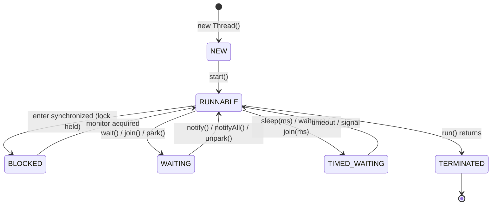

# 1. What are the possible thread states in Java?

> **Section:** Thread Fundamentals · **Level:** Architect / Tech Lead · **Related code:** `src/com/java/multithreading/interview/questions/ThreadStatesDemo.java`, `ThreadLifecycleDemo.java`

## TL;DR

A Java thread has exactly **six** states, defined by the `Thread.State` enum: `NEW`, `RUNNABLE`, `BLOCKED`, `WAITING`, `TIMED_WAITING`, and `TERMINATED`. The OS/JVM scheduler moves a thread between them; you observe them with `Thread.getState()`. Note that Java collapses the classic "RUNNING" and "READY" states into a single `RUNNABLE`.

## Deep Dive

### The six states

| State | Meaning | Typical trigger |
| --- | --- | --- |
| `NEW` | Created but `start()` not yet called | `new Thread(...)` |
| `RUNNABLE` | Eligible to run, may be executing or waiting for a CPU slice | `start()`, scheduler, lock granted |
| `BLOCKED` | Waiting to enter a `synchronized` region (monitor lock held by another thread) | lock contention |
| `WAITING` | Waiting **indefinitely** for another thread's action | `Object.wait()`, `Thread.join()`, `LockSupport.park()` |
| `TIMED_WAITING` | Waiting for a **bounded** time | `Thread.sleep(ms)`, `join(ms)`, `wait(ms)` |
| `TERMINATED` | `run()` has completed (normally or via exception) | end of `run()` |

### The subtle one: no RUNNING state

Java deliberately merges **READY** (runnable but not scheduled) and **RUNNING** (on a CPU) into `RUNNABLE`. You can therefore be in `RUNNABLE` while the OS has you parked. This is why `getState()` is a *coarse* health signal, not a CPU sampler.

## Diagram



## Code Walkthrough

`ThreadStatesDemo` forces three distinct states to co-exist so you can observe them:

```java
// src/com/java/multithreading/interview/questions/ThreadStatesDemo.java
public class ThreadStatesDemo {
    public static void main(String[] args) throws InterruptedException {
        final Object lock = new Object();

        Thread holder = new Thread(() -> {
            synchronized (lock) {
                try { Thread.sleep(1500); }
                catch (InterruptedException e) { Thread.currentThread().interrupt(); }
            }
        }, "Holder");

        Thread blocked = new Thread(() -> {
            synchronized (lock) { System.out.println("Blocked acquired"); }
        }, "Blocked");

        Thread sleeper = new Thread(() -> {
            try { Thread.sleep(2000); }
            catch (InterruptedException e) { Thread.currentThread().interrupt(); }
        }, "Sleeper");
        // ...
        System.out.println("Holder: "  + holder.getState());   // TIMED_WAITING
        System.out.println("Blocked: " + blocked.getState());  // BLOCKED
        System.out.println("Sleeper: " + sleeper.getState());  // TIMED_WAITING
    }
}
```

1. `Holder` grabs the monitor and `sleep()`s **while still holding it** → `TIMED_WAITING`.
2. `Blocked` tries to enter the same monitor → `BLOCKED`.
3. `Sleeper` calls `sleep()` but never touches the lock → `TIMED_WAITING`.
4. After `join()`, every thread reports `TERMINATED`.

## Architect / Tech-Lead Insights

- A thread dump (`jstack`) prints these exact states — they are the vocabulary for diagnosing hangs in production.
- Many threads in `BLOCKED` on the *same* monitor = lock contention hotspot.
- Threads stuck in `WAITING` forever = missed signal / lost `notify()`.
- A thread pool whose workers are all `TIMED_WAITING` on `poll()` is likely **idle**, not broken.

## Common Pitfalls

| Pitfall | Why it hurts | Fix |
| --- | --- | --- |
| Reading state twice and assuming it is stable | States change between calls | Sample once; treat state as a hint |
| Confusing `BLOCKED` and `WAITING` | Different root causes | `BLOCKED` = monitor contention, `WAITING` = signal |
| Assuming `RUNNABLE` means "on CPU" | READY is folded in | Use a profiler for real CPU time |
| Expecting `getState()` after death to throw | It simply returns `TERMINATED` | Check `isAlive()` instead |

## Interview Q&A

**Q:** How many states and where are they defined?
**A:** Six, in the `Thread.State` enum.

**Q:** What is the difference between `BLOCKED` and `WAITING`?
**A:** `BLOCKED` waits for a monitor lock implicitly; `WAITING` waits for an explicit signal/timeout.

## Related Questions

- [2. How does a thread transition from NEW to RUNNABLE?](2.How%20does%20a%20thread%20transition%20from%20NEW%20to%20RUNNABLE.MD)
- [3. What does the TERMINATED state mean?](3.What%20does%20the%20TERMINATED%20state%20mean.MD)
- [17. How do you interrupt a running thread?](17.%20How%20do%20you%20interrupt%20a%20running%20thread.md)
