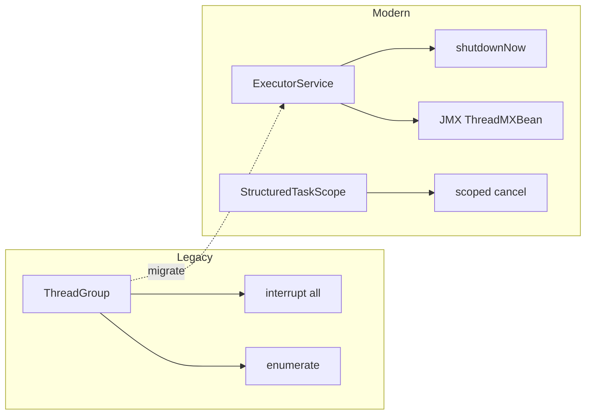

# 10. Are thread groups recommended for modern applications?

> **Section:** Thread Fundamentals · **Level:** Architect / Tech Lead · **Related code:** `src/com/java/multithreading/interview/questions/ThreadGroupExample.java`

## TL;DR

Generally **no**. Thread groups are a legacy API. Modern designs use `ExecutorService` (and its thread factories) for lifecycle management, structured concurrency for cancellation scopes, and JMX/`ThreadMXBean` for monitoring. The one still-useful capability — bulk `interrupt()` — is now better served by `shutdownNow()` or structured-concurrency scopes.

## Deep Dive

### Why they fell out of favour

| Need | Legacy (ThreadGroup) | Modern alternative |
| --- | --- | --- |
| Bulk cancel | `group.interrupt()` | `ExecutorService.shutdownNow()` |
| Pooling | manual groups | `ThreadPoolExecutor` |
| Monitoring | `enumerate()` | JMX, `ThreadMXBean`, async-profiler |
| Error policy | group handler | pool `ThreadFactory` + `UncaughtExceptionHandler` |
| Cancellation scope | group | Structured concurrency `StructuredTaskScope` |

### When a group is still acceptable

- Small ad-hoc utilities that need to interrupt a handful of related threads together.
- Interop with older libraries that already expose groups.

## Diagram



## Code Walkthrough

The pattern to migrate toward — a managed pool that interrupts all workers on shutdown:

```java
ExecutorService pool = Executors.newFixedThreadPool(8, r -> {
    Thread t = new Thread(r, "worker");
    t.setUncaughtExceptionHandler((th, ex) -> log(th, ex));
    return t;
});
// ...
pool.shutdownNow();   // interrupts every worker — the group.interrupt() use case
```

`ThreadGroupExample` remains valuable as a *teaching* demo of the group API:

```java
// src/com/java/multithreading/interview/questions/ThreadGroupExample.java
group.interrupt();          // broadcasts to all threads in the group
group.setMaxPriority(7);    // cap priorities for the group
```

## Architect / Tech-Lead Insights

- Standardise on executors + custom `ThreadFactory` so naming, daemon status, priority caps, and uncaught-exception handling are consistent across the fleet.
- For request-scoped cancellation (e.g., "cancel everything for this request"), structured concurrency is the modern, safer model — cancellation is lexical and cannot leak.
- Keep an eye on deprecated `ThreadGroup` usages in legacy code during reviews; flag them for migration.

## Common Pitfalls

| Pitfall | Why it hurts | Fix |
| --- | --- | --- |
| Building new APIs on groups | Legacy, weak guarantees | Use executors / structured concurrency |
| Using groups as a security boundary | Not designed for that | Container / module isolation |
| Manual thread bookkeeping | Leaks, hard to cancel | Pools + structured scopes |

## Interview Q&A

**Q:** What replaced thread groups?
**A:** Executors, structured concurrency, and JMX-based monitoring.

**Q:** Is there any reason to use them today?
**A:** Only for simple bulk-interrupt utilities or legacy interop.

## Related Questions

- [9. What are thread groups in Java?](9.What%20are%20thread%20groups%20in%20Java.md)
- [140. What is structured concurrency?](../7.%20Concurrency%20Patterns/README.md#140-what-is-structured-concurrency)
