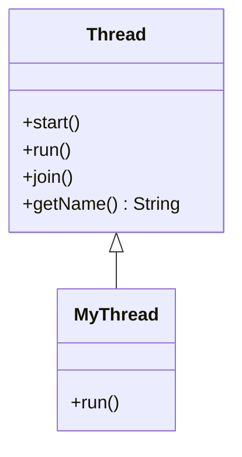

# 11. How do you create a thread using the Thread class?

> **Section:** Thread Fundamentals · **Level:** Architect / Tech Lead · **Related code:** `src/com/java/javathread/ThreadExample2.java`, `src/com/java/startingthreads/App.java`

## TL;DR

Extend `Thread` and override `run()`, then call `start()`. This is the most direct way to create a thread, but it couples the *task* to the *thread* and blocks you from extending any other class (Java has single inheritance). Prefer `Runnable`/`Callable` for anything beyond a quick demo.

## Deep Dive

### Two flavours of "Thread class"

1. **Subclass `Thread`** and override `run()`.
2. **Anonymous subclass** or lambda passed to `new Thread(...)` (technically a `Runnable` under the hood).

### The contract

| Member | Purpose |
| --- | --- |
| `run()` | The task; called by the JVM on the new thread |
| `start()` | Creates the OS thread and calls `run()` on it |
| `getName()` | Thread name (defaults to `Thread-N`) |
| `join()` | Wait for the thread to finish |

## Diagram



## Code Walkthrough

```java
// src/com/java/javathread/ThreadExample2.java
public class ThreadExample2 {
    public static class MyThread extends Thread {
        public void run() {
            System.out.println("MyThread running");
            System.out.println("MyThread finished");
        }
    }
    public static void main(String[] args) {
        MyThread myThread = new MyThread();
        myThread.start();          // NEW -> RUNNABLE
    }
}
```

`startingthreads/App` repeats the pattern for two independent `Runner` threads:

```java
// src/com/java/startingthreads/App.java
class Runner extends Thread {
    public void run() { /* prints 0..9 with a 1s sleep */ }
}
Runner runner = new Runner();
runner.start();
```

1. `MyThread extends Thread` ties the task to the thread type.
2. `start()` runs `run()` on a **new** OS thread.

## Architect / Tech-Lead Insights

- Extending `Thread` wastes your single inheritance slot and prevents pooling — a `Thread` runs exactly once.
- For production, decouple: `Runnable`/`Callable` + `ExecutorService`.
- Naming threads (`new Thread(task, "order-loader-3")`) is a small choice with outsized debugging value.

## Common Pitfalls

| Pitfall | Why it hurts | Fix |
| --- | --- | --- |
| Calling `run()` directly | No concurrency | Call `start()` |
| Reusing a `Thread` instance | `IllegalThreadStateException` | New thread / pool task |
| Extending `Thread` for reuse | Can't extend other classes | Prefer `Runnable` |

## Interview Q&A

**Q:** Difference between `Thread` subclass and a `Runnable`?
**A:** Subclassing binds task to thread and burns inheritance; `Runnable` separates concerns and works with pools.

## Related Questions

- [12. How do you create a thread using Runnable?](12.%20How%20do%20you%20create%20a%20thread%20using%20Runnable.md)
- [14. Runnable vs extending Thread](14.%20What%20are%20the%20pros%25cons%20of%20implementing%20Runnable%20vs%20extending%20Thread.md)
