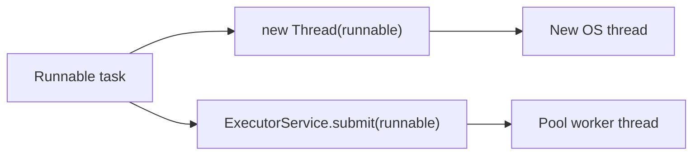

# 12. How do you create a thread using Runnable?

> **Section:** Thread Fundamentals · **Level:** Architect / Tech Lead · **Related code:** `src/com/java/javathread/ThreadExample3.java`, `ThreadExample4.java`, `ThreadExample5.java`, `src/com/java/runnable/App.java`

## TL;DR

Implement `Runnable` (class, anonymous class, or lambda) and pass it to `new Thread(runnable).start()`. This separates the **task** (`Runnable`) from the **thread** (`Thread`), keeps your inheritance slot free, and — crucially — lets the same task run on a thread pool.

## Deep Dive

### Three idiomatic forms

| Form | Example | Use |
| --- | --- | --- |
| Named class | `class MyRunnable implements Runnable` | Reusable task |
| Anonymous class | `new Runnable(){ public void run(){...} }` | Pre-Java-8 style |
| Lambda | `() -> { ... }` | Modern, concise |

### Why it is preferred

- `Runnable` is a `@FunctionalInterface` → works with lambdas.
- Same instance can be submitted to many executors.
- Decouples "what to do" from "how it runs".

## Diagram



## Code Walkthrough

Named class (`ThreadExample3`):

```java
// src/com/java/javathread/ThreadExample3.java
public static class MyRunable implements Runnable {
    public void run() {
        System.out.println("MyRunnable running");
        System.out.println("MyRunnable finished");
    }
}
Thread thread = new Thread(new MyRunable());
thread.start();
```

Anonymous class (`ThreadExample4`) and lambda (`ThreadExample5`):

```java
// src/com/java/javathread/ThreadExample5.java
Runnable runnable = () -> {
    System.out.println("Lambda running");
    System.out.println("Lambda finished");
};
Thread thread = new Thread(runnable);
thread.start();
```

Two independent tasks (`runnable/App`):

```java
// src/com/java/runnable/App.java
Thread t1 = new Thread(new Runner());
Thread t2 = new Thread(new Runner());
t1.start();
t2.start();
```

## Architect / Tech-Lead Insights

- Standardise on `Runnable`/`Callable` + pools: it enables backpressure, bounded concurrency, metrics, and graceful shutdown — none of which you get with raw `Thread`s.
- Lambdas + `Runnable` is the default style in modern Java codebases.
- Because `Runnable` cannot return a value or throw checked exceptions, reach for `Callable` when you need results.

## Common Pitfalls

| Pitfall | Why it hurts | Fix |
| --- | --- | --- |
| Sharing mutable state across `Runnable` instances | Race conditions | Confine state / synchronize |
| Reusing a `Thread`, not a `Runnable` | `IllegalThreadStateException` | Reuse the `Runnable`, new thread |
| Ignoring exceptions in `run()` | Silent failures | Try/catch + logging |

## Interview Q&A

**Q:** Can one `Runnable` be shared by multiple threads?
**A:** Yes — but then its shared mutable fields must be thread-safe.

**Q:** Is `Runnable` a functional interface?
**A:** Yes (single abstract method `run()`), so lambdas work.

## Related Questions

- [13. How do you create a thread using Callable and Future?](13.%20How%20do%20you%20create%20a%20thread%20using%20Callable%20and%20Future.md)
- [14. Runnable vs extending Thread](14.%20What%20are%20the%20pros%25cons%20of%20implementing%20Runnable%20vs%20extending%20Thread.md)
