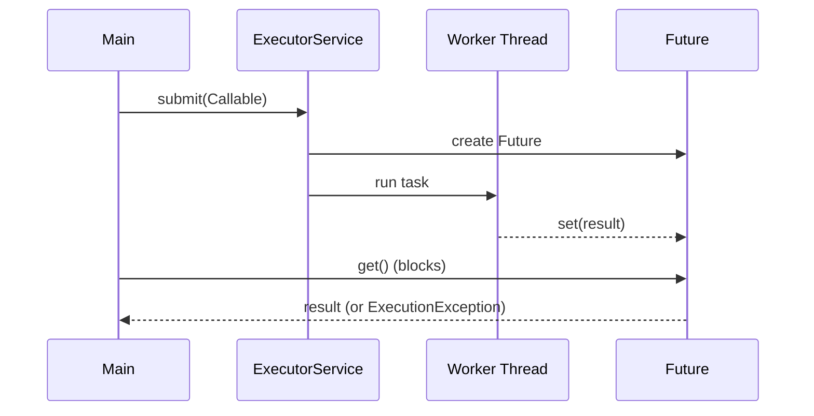

# 13. How do you create a thread using Callable and Future?

> **Section:** Thread Fundamentals · **Level:** Architect / Tech Lead · **Related code:** `src/com/java/multithreading/interview/questions/ThreadRunnableCallableDemo.java`, `src/com/java/countdownlatches/App.java`

## TL;DR

`Callable<V>` is like `Runnable` but **returns a value** and **can throw checked exceptions**. Submit it to an `ExecutorService`, which returns a `Future<V>`. `future.get()` blocks until the result is ready — wrap it in a timeout in production. `Callable` cannot be passed directly to `new Thread(...)`; use an executor or a `FutureTask`.

## Deep Dive

### Callable vs Runnable

| Feature | `Runnable` | `Callable<V>` |
| --- | --- | --- |
| Return value | No (`void`) | Yes (`V`) |
| Checked exceptions | No | Yes |
| Runs on | Thread / executor | Executor (or `FutureTask`) |

### Future API

| Method | Behaviour |
| --- | --- |
| `get()` | Blocks until done; throws `ExecutionException` on task failure |
| `get(timeout, unit)` | Blocks up to timeout; throws `TimeoutException` |
| `cancel(true)` | Attempts to interrupt a running task |
| `isDone()` / `isCancelled()` | Non-blocking status |

## Diagram



## Code Walkthrough

```java
// src/com/java/multithreading/interview/questions/ThreadRunnableCallableDemo.java
Callable<String> callableTask = () -> {
    Thread.sleep(500);
    return " return the Callable result";
};
ExecutorService executor = Executors.newSingleThreadExecutor();
Future<String> future = executor.submit(callableTask);
System.out.println(future.get());     // blocks -> " return the Callable result"
executor.shutdown();
```

`countdownlatches/App` shows the *coordination* cousin — a `CountDownLatch` waits for 3 submitted tasks:

```java
// src/com/java/countdownlatches/App.java
CountDownLatch latch = new CountDownLatch(3);
ExecutorService executor = Executors.newFixedThreadPool(3);
for (int i = 0; i < 3; i++) executor.submit(new Processor(latch));
latch.await();                        // wait for all three to countDown()
System.out.println("Completed...");
```

## Architect / Tech-Lead Insights

- **Always use a timeout**: `future.get(2, TimeUnit.SECONDS)`. Unbounded `get()` is a latency landmine.
- A thrown exception inside a `Callable` surfaces as `ExecutionException` on `get()` — unwrap `getCause()` to see the real error.
- `CompletableFuture` (Java 8+) is the modern, composable successor for chaining async work.
- For "wait for N tasks", a `CountDownLatch` or `invokeAll` is often cleaner than N separate `Future.get()` calls.

## Common Pitfalls

| Pitfall | Why it hurts | Fix |
| --- | --- | --- |
| `get()` with no timeout | Thread can block forever | Always pass a timeout |
| Ignoring `ExecutionException` | Real error hidden | Inspect `getCause()` |
| Forgetting `shutdown()` | JVM won't exit | `shutdown()` + `awaitTermination` |
| Passing `Callable` to `Thread` | Doesn't compile | Use an executor / `FutureTask` |

## Interview Q&A

**Q:** Difference between `Future.get()` and `CountDownLatch.await()`?
**A:** `get()` returns a *value* and propagates the task's exception; `await()` only signals completion.

**Q:** How do you cancel a task?
**A:** `future.cancel(true)` — which interrupts the running thread.

## Related Questions

- [12. How do you create a thread using Runnable?](12.%20How%20do%20you%20create%20a%20thread%20using%20Runnable.md)
- [69. What is a CompletableFuture?](../4.%20Concurrency%20Utilities/README.md#69-what-is-completablefuture)
