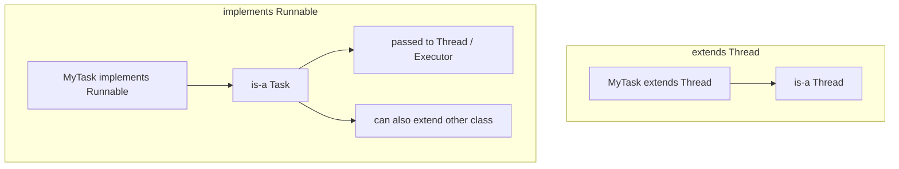

# 14. What are the pros/cons of implementing Runnable vs extending Thread?

> **Section:** Thread Fundamentals · **Level:** Architect / Tech Lead · **Related code:** `src/com/java/javathread/ThreadExample2.java` (extends Thread), `ThreadExample3.java` (implements Runnable)

## TL;DR

Implement **`Runnable`** in almost all cases. It separates the task from the thread, keeps your inheritance slot free, works with lambdas, and is compatible with thread pools. Extending `Thread` is simpler for throwaway demos but couples task and thread, burns single inheritance, and cannot be pooled.

## Deep Dive

### Head-to-head

| Criterion | `implements Runnable` | `extends Thread` |
| --- | --- | --- |
| Inheritance | Free to extend another class | Consumes the only superclass slot |
| Reuse/pooling | Yes (same task to many executors) | No (thread runs once) |
| Separation of concerns | Task ≠ thread | Task == thread |
| Lambda friendly | Yes (functional interface) | No |
| Return value / exceptions | No / No (use `Callable`) | No / No |
| Simplicity for a quick demo | Slightly more code | Slightly less |

## Diagram



## Code Walkthrough

Extending `Thread` (`ThreadExample2`):

```java
// src/com/java/javathread/ThreadExample2.java
public static class MyThread extends Thread {
    public void run() { System.out.println("MyThread running"); }
}
new MyThread().start();
```

Implementing `Runnable` (`ThreadExample3`):

```java
// src/com/java/javathread/ThreadExample3.java
public static class MyRunable implements Runnable {
    public void run() { System.out.println("MyRunnable running"); }
}
new Thread(new MyRunable()).start();
```

The `Runnable` version can now be handed to any executor without change:

```java
ExecutorService pool = Executors.newFixedThreadPool(4);
pool.submit(new MyRunable());
```

## Architect / Tech-Lead Insights

- Prefer composition (task object) over inheritance (thread subclass) — the same principle that makes `Runnable` superior here applies across concurrency design.
- If you need a return value or checked exceptions, skip both and use `Callable<V>`.
- A useful review heuristic: **any `extends Thread` in application code is a smell** and usually wants to become `Runnable`.

## Common Pitfalls

| Pitfall | Why it hurts | Fix |
| --- | --- | --- |
| `extends Thread` in business logic | Blocks inheritance, kills pooling | Use `Runnable` |
| Expecting a return value | `Runnable` cannot | Use `Callable` |
| Sharing mutable state | Races | Confine or synchronize |

## Interview Q&A

**Q:** Which is preferred and why?
**A:** `Runnable` — separation of concerns, inheritance freedom, pool compatibility.

**Q:** When might `extends Thread` be acceptable?
**A:** Tiny one-off demos or scripts where reuse and pooling are irrelevant.

## Related Questions

- [11. How do you create a thread using the Thread class?](11.%20How%20do%20you%20create%20a%20thread%20using%20the%20Thread%20class.md)
- [12. How do you create a thread using Runnable?](12.%20How%20do%20you%20create%20a%20thread%20using%20Runnable.md)
