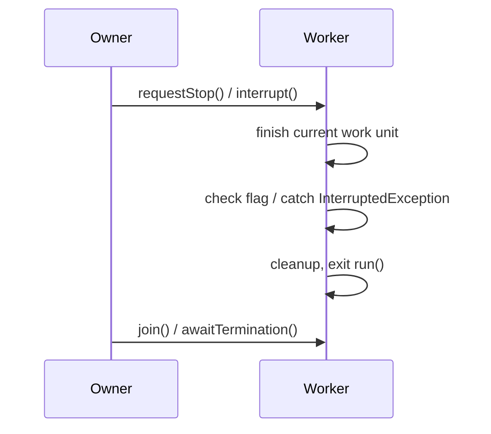

# 15. How do you stop a thread safely?

> **Section:** Thread Fundamentals · **Level:** Architect / Tech Lead · **Related code:** `src/com/java/javathread/ThreadExample8.java`, `src/com/java/synchronization/App.java`

## TL;DR

You cannot force a thread to stop; cancellation is **cooperative**. Two idioms work: (1) a **`volatile` (or otherwise safely published) flag** the thread checks in its loop, and (2) **`interrupt()`**, which the thread observes via `isInterrupted()` or an `InterruptedException`. Always let the thread exit from a clean point so shared state stays consistent.

## Deep Dive

### The two cooperative mechanisms

| Mechanism | How the thread notices | Best for |
| --- | --- | --- |
| Volatile stop flag | Polls `isStopRequested()` each iteration | Long compute loops, custom workers |
| `interrupt()` | `Thread.isInterrupted()` / `InterruptedException` | Threads blocked in `sleep`/`wait`/`join`/I/O |

### Shutdown checklist

1. Signal (flag or interrupt).
2. Thread finishes its current unit of work / rolls back safely.
3. Thread exits `run()`.
4. Owner `join()`s or `awaitTermination()`s.

## Diagram



## Code Walkthrough

`ThreadExample8` uses a synchronized (safely published) stop flag:

```java
// src/com/java/javathread/ThreadExample8.java
public static class StoppableRunnable implements Runnable {
    private boolean stopRequested = false;
    public synchronized void requestStop()   { this.stopRequested = true; }
    public synchronized boolean isStopRequested() { return this.stopRequested; }
    public void run() {
        System.out.println("Running");
        while (!isStopRequested()) {
            sleep(1000);
            System.out.println("...");
        }
        System.out.println("Stopped");
    }
}
// ...
stoppableRunnable.requestStop();
```

`synchronization/App` uses a `volatile` flag — the minimal correct form:

```java
// src/com/java/synchronization/App.java
class Processor extends Thread {
    private volatile boolean running = true;
    public void run() { while (running) { /* work */ } }
    public void shutdown() { running = false; }
}
// ...
process.shutdown();
```

## Architect / Tech-Lead Insights

- Make cancellation *observable*: a bounded loop that checks the flag/interrupt regularly, not once at the very end.
- Prefer `volatile` or a synchronized accessor for the flag; an ordinary `boolean` field gives no visibility guarantee (see the memory-model section).
- For pools, `shutdown()` (drain) vs `shutdownNow()` (interrupt) is the cancellation surface — use the one matching your durability needs.
- Document whether stop is **graceful** (finish current item) or **immediate** (interrupt).

## Common Pitfalls

| Pitfall | Why it hurts | Fix |
| --- | --- | --- |
| `Thread.stop()` | Can corrupt state | Use cooperative flags/interrupt |
| Non-volatile flag | Thread may never see the change | `volatile` / synchronized |
| Swallowing `InterruptedException` | Loses the cancel signal | Re-interrupt or propagate |
| No timeout on shutdown | Process hangs | `awaitTermination(timeout)` |

## Interview Q&A

**Q:** Can you stop a thread the way you stop a process?
**A:** No — Java offers only cooperative cancellation.

**Q:** What is the minimal correct stop flag?
**A:** A `volatile boolean` checked in the run loop.

## Related Questions

- [16. Why is Thread.stop() deprecated?](16.%20Why%20is%20Thread.stop%28%29%20deprecated.md)
- [17. How do you interrupt a running thread?](17.%20How%20do%20you%20interrupt%20a%20running%20thread.md)
- [19. What is cooperative thread termination?](19.%20What%20is%20cooperative%20thread%20termination.md)
