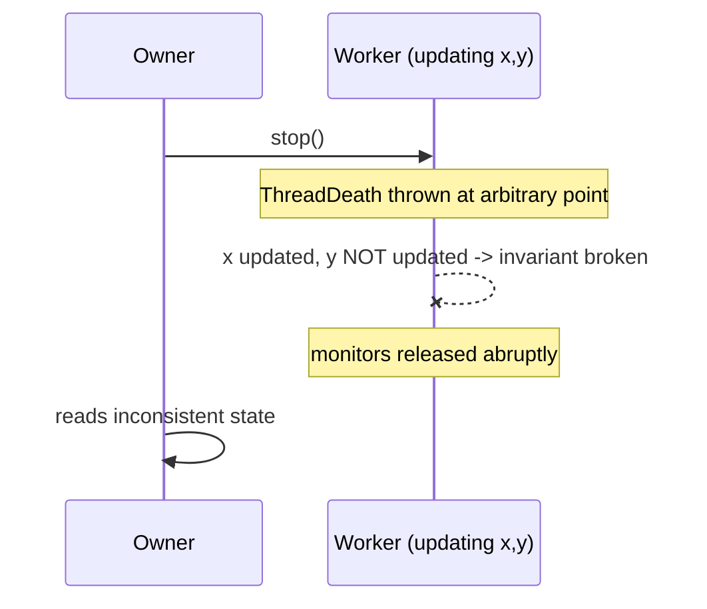

# 16. Why is Thread.stop() deprecated?

> **Section:** Thread Fundamentals · **Level:** Architect / Tech Lead · **Related code:** `src/com/java/multithreading/interview/questions/InterruptDemo.java` (the safe alternative)

## TL;DR

`Thread.stop()` is deprecated because it kills a thread **asynchronously and unconditionally**, at an arbitrary bytecode boundary. That can leave shared objects in a half-updated, inconsistent state, release monitors abruptly, and hide the real error. Cancellation must instead be **cooperative** via `interrupt()` or a stop flag.

## Deep Dive

### What `stop()` does wrong

`Thread.stop()` throws a `ThreadDeath` error in the target thread *at whatever point it happens to be*. Consequences:

1. **Corrupt shared state** — a compound update (`x++`, or a multi-field invariant) can be torn in half.
2. **Abrupt monitor release** — every lock the thread held is released immediately, exposing partly modified data to other threads.
3. **Silent failure** — `ThreadDeath` is an `Error` that can be swallowed, hiding the termination.
4. **No cleanup** — `finally` blocks *may* run, but not reliably, and not at a safe point.

### Deprecated companions

| Method | Status | Reason |
| --- | --- | --- |
| `Thread.stop()` | Deprecated (Java 1.2+, removed semantics) | Async kill → corruption |
| `Thread.suspend()` / `resume()` | Deprecated | Can deadlock (held locks) |
| `Thread.destroy()` | Never implemented | Unsafe |
| `Runtime.runFinalizersOnExit()` | Deprecated | Unsafe |

## Diagram



## Code Walkthrough

There is deliberately **no** `stop()` demo in this repository — the safe pattern is interception:

```java
// src/com/java/multithreading/interview/questions/InterruptDemo.java
Thread worker = new Thread(() -> {
    while (!Thread.currentThread().isInterrupted()) {
        System.out.println("Worker running...");
    }
    System.out.println("Worker exiting gracefully");
});
worker.start();
Thread.sleep(1600);
worker.interrupt();     // cooperative: the safe replacement for stop()
worker.join();
```

The worker chooses *where* to stop, guaranteeing its invariants hold.

## Architect / Tech-Lead Insights

- Treat any remaining `Thread.stop()`/`suspend()`/`resume()` in the codebase as a **P1 review finding** — they are latent corruption bugs.
- Migrate to an `ExecutorService`: `cancel(true)` + `shutdownNow()` implements cooperative cancellation with interrupt semantics.
- If a library thread seems "unstoppable", the fix is a timeout on the blocking call, not a forced kill.

## Common Pitfalls

| Pitfall | Why it hurts | Fix |
| --- | --- | --- |
| Using `stop()` for "emergency" shutdown | State corruption | `interrupt()` + cooperative check |
| Swallowing `ThreadDeath` | Hides termination | Don't catch `Error` broadly |
| Assuming `suspend()` is safe | Deadlocks on held locks | Never use it |

## Interview Q&A

**Q:** Why exactly is `stop()` unsafe?
**A:** It injects `ThreadDeath` at an arbitrary point, tearing compound state and releasing monitors mid-update.

**Q:** What replaced it?
**A:** Cooperative `interrupt()` / stop flags, plus executor `cancel`/`shutdownNow`.

## Related Questions

- [15. How do you stop a thread safely?](15.%20How%20do%20you%20stop%20a%20thread%20safely.md)
- [17. How do you interrupt a running thread?](17.%20How%20do%20you%20interrupt%20a%20running%20thread.md)
