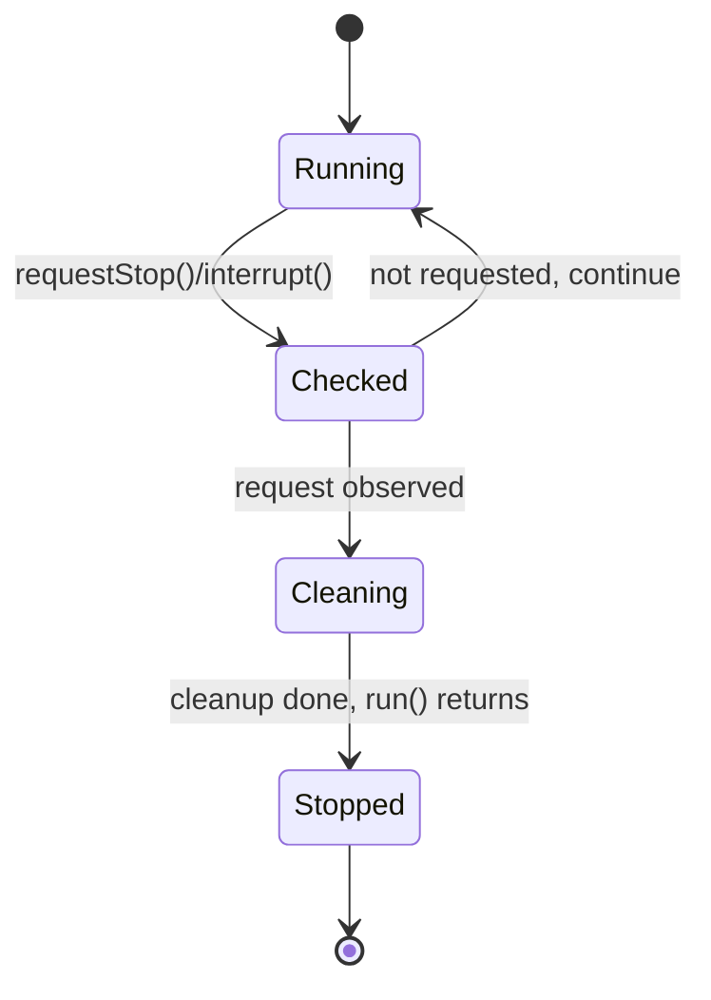

# 19. What is cooperative thread termination?

> **Section:** Thread Fundamentals · **Level:** Architect / Tech Lead · **Related code:** `src/com/java/javathread/ThreadExample8.java`, `src/com/java/synchronization/App.java`

## TL;DR

Cooperative termination means the **thread decides when to stop** — the owner *requests* cancellation (via a flag or `interrupt()`) and the worker checks for it at safe points and exits cleanly. Java is cooperative by design because abrupt termination (`Thread.stop()`) is unsafe. The payoff: shared state stays consistent and cleanup runs.

## Deep Dive

### The contract

- **Owner** signals: `requestStop()` or `interrupt()`.
- **Worker** observes at safe points: loop condition, between work units, or when an `InterruptedException` fires.
- **Worker** cleans up and returns from `run()`.
- **Owner** waits: `join()` / `awaitTermination()`.

### Choosing a mechanism

| Mechanism | Latency | Notes |
| --- | --- | --- |
| `volatile` flag | Up to one loop iteration | Simple, non-blocking work |
| `interrupt()` | Immediate on blocking calls | Works with `sleep/wait/join` |
| Both | Best of both | Flag for compute, interrupt for waits |

## Diagram



## Code Walkthrough

`ThreadExample8`'s `StoppableRunnable` is a textbook cooperative worker:

```java
// src/com/java/javathread/ThreadExample8.java
while (!isStopRequested()) {   // safe point 1: loop condition
    sleep(1000);               // safe point 2: an interruptible wait
    System.out.println("...");
}
System.out.println("StoppableRunnable Stopped");   // clean exit
```

`synchronization/App` shows the minimal volatile-flag variant:

```java
// src/com/java/synchronization/App.java
private volatile boolean running = true;
public void run() { while (running) { /* work */ } }
public void shutdown() { running = false; }
```

1. The flag is `volatile`, so the write is visible to the worker.
2. The worker checks it every iteration.
3. On request, it leaves the loop and finishes `run()`.

## Architect / Tech-Lead Insights

- Design worker loops with an explicit **safe point** for cancellation — this bounds shutdown latency and prevents "stuck on shutdown" incidents.
- Combine both mechanisms for robustness: a flag for tight compute and `interrupt` for whatever else is blocking.
- Pairs naturally with structured concurrency, where cancellation propagates down the task tree deterministically.

## Common Pitfalls

| Pitfall | Why it hurts | Fix |
| --- | --- | --- |
| Non-volatile flag | Worker never sees the request | `volatile`/synchronized |
| Checking only at the very end | Long shutdown latency | Check every iteration |
| Blocking without interrupt handling | Cannot cancel | Use interruptible waits |
| No `join`/`await` after request | Owner proceeds before cleanup | Wait for termination |

## Interview Q&A

**Q:** Why is Java termination cooperative?
**A:** Async kill is unsafe; cooperation preserves invariants.

**Q:** What makes a good safe point?
**A:** A loop condition or an interruptible blocking call checked frequently enough to bound latency.

## Related Questions

- [15. How do you stop a thread safely?](15.%20How%20do%20you%20stop%20a%20thread%20safely.md)
- [17. How do you interrupt a running thread?](17.%20How%20do%20you%20interrupt%20a%20running%20thread.md)
