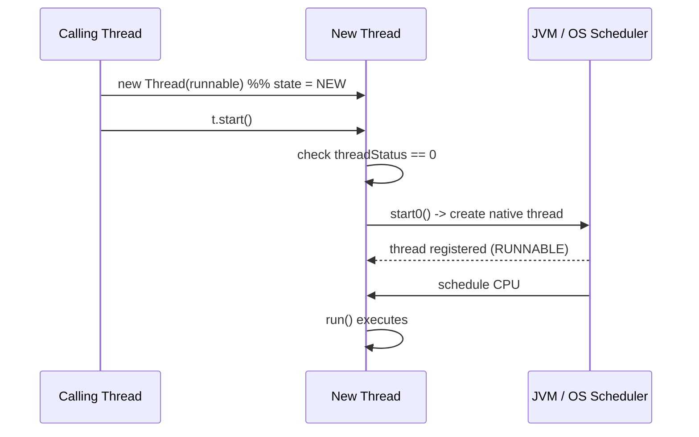

# 2. How does a thread transition from NEW to RUNNABLE?

> **Section:** Thread Fundamentals · **Level:** Architect / Tech Lead · **Related code:** `src/com/java/multithreading/interview/questions/ThreadLifecycleDemo.java`, `src/com/java/javathread/ThreadExample.java`

## TL;DR

A thread created with `new Thread(...)` is in `NEW`. The **only** supported transition to `RUNNABLE` is `start()`. Internally `start()` asks the JVM to create a native OS thread, registers it with the thread scheduler, and only then invokes `run()` on the new thread. Calling `run()` directly does **not** change the state — it executes on the calling thread.

## Deep Dive

### What `start()` actually does

1. Checks the thread has not already been started (`threadStatus == 0`), else throws `IllegalThreadStateException`.
2. Notifies the **ThreadGroup**.
3. Calls the native `start0()`, which creates the OS thread and adds it to the scheduler.
4. The new OS thread immediately calls `run()`.

### `start()` vs `run()`

| Call | New thread? | State after | Use |
| --- | --- | --- | --- |
| `t.start()` | Yes | `RUNNABLE` | Correct way to run concurrently |
| `t.run()` | No | stays `NEW` | Plain method call on caller thread |

## Diagram



## Code Walkthrough

```java
// src/com/java/multithreading/interview/questions/ThreadLifecycleDemo.java
Thread t = new Thread(() -> {
    try { Thread.sleep(1000); } catch (InterruptedException e) { e.printStackTrace(); }
});
System.out.println("State before start: " + t.getState()); // NEW
t.start();
Thread.sleep(100);                                        // let it start
System.out.println("State after start: " + t.getState());  // RUNNABLE / TIMED_WAITING
t.join();
System.out.println("After termination: " + t.getState());  // TERMINATED
```

1. Before `start()`, `getState()` returns `NEW`.
2. `start()` performs the NEW → RUNNABLE transition.
3. The sample may already show `TIMED_WAITING` because `sleep(1000)` begins immediately.

## Architect / Tech-Lead Insights

- Starting thousands of threads eagerly blows the OS thread limit; use pools (`ExecutorService`) so `NEW → RUNNABLE` is bounded by a managed worker count.
- `start()` throwing `IllegalThreadStateException` is a common bug when a `Thread` instance is reused (it cannot be — create a new one or use a `Runnable`).
- Prefer `Runnable`/`Callable` so the "task" is decoupled from the "thread" and can be resubmitted safely.

## Common Pitfalls

| Pitfall | Why it hurts | Fix |
| --- | --- | --- |
| Calling `run()` instead of `start()` | Runs synchronously, no concurrency | Always `start()` |
| Reusing a `Thread` object | `IllegalThreadStateException` | New `Thread` (or pool task) each time |
| Assuming RUNNABLE means "running now" | It includes READY | Profile for CPU usage |

## Interview Q&A

**Q:** Can a thread go back from RUNNABLE to NEW?
**A:** No. `NEW` is a one-way, pre-start state.

**Q:** What exception does a second `start()` throw?
**A:** `IllegalThreadStateException`.

## Related Questions

- [1. What are the possible thread states in Java?](1.What%20are%20the%20possible%20thread%20states%20in%20Java.MD)
- [11. How do you create a thread using the Thread class?](11.%20How%20do%20you%20create%20a%20thread%20using%20the%20Thread%20class.md)
