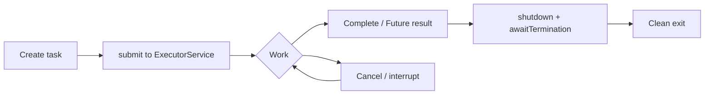

# 20. What are best practices for handling thread lifecycle?

> **Section:** Thread Fundamentals · **Level:** Architect / Tech Lead · **Related code:** `src/com/java/threadpools/App.java`, `src/com/java/javathread/ThreadExample10.java`

## TL;DR

Prefer **managed execution** over raw threads: use `ExecutorService` (or a higher-level abstraction) with a bounded pool, named daemon-aware threads, an uncaught-exception handler, and a deliberate shutdown. Avoid `Thread.stop()`, always handle `InterruptedException`, avoid daemon threads for critical work, and never rely on thread priority for correctness.

## Deep Dive

### Lifecycle checklist

| Phase | Best practice |
| --- | --- |
| Create | `Runnable`/`Callable` + pool; name threads; bounded size |
| Start | `start()` (or `submit`); set daemon/priority only before start |
| Run | Poll interrupt; handle `InterruptedException`; use safe points |
| Stop | Cooperative: flag/interrupt; `shutdown()`/`shutdownNow()` |
| Await | `join()` / `awaitTermination(timeout)` |
| Observe | JMX, thread names, uncaught-exception handlers |

### Pool instead of raw threads

Raw threads are unbounded: N requests → N threads → context-switch storm / OOM. Pools bound concurrency and enable backpressure.

## Diagram



## Code Walkthrough

This Java 8-compatible example uses a bounded work queue and an explicit rejection policy:

```java
ThreadFactory factory = task -> {
    Thread worker = new Thread(task, "worker");
    worker.setUncaughtExceptionHandler((thread, error) ->
        System.err.println(thread.getName() + " failed: " + error));
    return worker;
};
ThreadPoolExecutor executor = new ThreadPoolExecutor(
    2, 2, 0L, TimeUnit.MILLISECONDS,
    new ArrayBlockingQueue<Runnable>(32),
    factory,
    new ThreadPoolExecutor.AbortPolicy());
for (int i = 0; i < 5; i++) executor.execute(new Processor(i));
executor.shutdown();
try {
    if (!executor.awaitTermination(30, TimeUnit.SECONDS)) {
        executor.shutdownNow();
        if (!executor.awaitTermination(30, TimeUnit.SECONDS)) {
            System.err.println("Executor did not terminate");
        }
    }
} catch (InterruptedException e) {
    executor.shutdownNow();
    Thread.currentThread().interrupt();
}
```

The queue capacity and rejection policy are workload decisions. When using `submit()` instead of `execute()`, observe each returned `Future`: task exceptions are captured by the future and do not reach the thread's uncaught-exception handler.

`ThreadExample10` shows the daemon + `join` idiom when you *do* need to wait for abandoned-safe work:

```java
// src/com/java/javathread/ThreadExample10.java
thread.setDaemon(true);
thread.start();
thread.join();
```

## Architect / Tech-Lead Insights

- Name every thread/pool (`new Thread(r, "orders-worker-3")`): it is the cheapest debugging investment you can make.
- Use an `UncaughtExceptionHandler` for failures escaping `execute()` tasks; observe `Future`s for failures from `submit()`.
- Bound everything: pool size, queue length, timeouts. Unbounded anything is a production incident waiting to happen.
- Prefer high-level abstractions (CompletableFuture, parallel streams, virtual threads, structured concurrency) over hand-rolled thread lifecycles.

## Common Pitfalls

| Pitfall | Why it hurts | Fix |
| --- | --- | --- |
| New thread per request | Unbounded → collapse | Bounded pool |
| Ignoring shutdown | JVM hangs, data loss | `shutdown` + `awaitTermination` |
| Unnamed threads | Useless thread dumps | Always name threads |
| Ignoring task failures | Silent failures | Observe `Future`s; handle uncaught `execute()` failures |
| Relying on priority/daemon for correctness | Non-portable | Explicit design |

## Interview Q&A

**Q:** What single change most improves thread hygiene?
**A:** Replace raw `new Thread(...)` with a managed, named, bounded executor + explicit shutdown.

**Q:** How do you make shutdown deterministic?
**A:** Cooperative cancel + `awaitTermination(timeout)` + a shutdown hook for last-resort cleanup.

## Related Questions

- [6. User vs daemon threads](6.What%20is%20the%20difference%20between%20user%20threads%20and%20daemon%20threads.MD)
- [15. How do you stop a thread safely?](15.%20How%20do%20you%20stop%20a%20thread%20safely.md)
- [65. What is the advantage of using thread pools?](../4.%20Concurrency%20Utilities/README.md#65-why-use-thread-pools)
