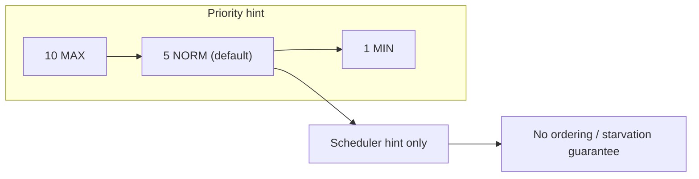

# 4. What is the difference between thread priority levels?

> **Section:** Thread Fundamentals · **Level:** Architect / Tech Lead · **Related code:** `src/com/java/javathread/ThreadExample6.java`

## TL;DR

Java exposes ten priority levels (1–10) via `Thread.MIN_PRIORITY` (1), `NORM_PRIORITY` (5, the default) and `MAX_PRIORITY` (10). Priority is only a **hint** to the scheduler: a higher-priority runnable thread is *more likely* to be scheduled first, but Java makes **no guarantee** that it runs before, more often than, or instead of a lower-priority thread.

## Deep Dive

### The three named constants

| Constant | Value | Meaning |
| --- | --- | --- |
| `Thread.MIN_PRIORITY` | 1 | Lowest |
| `Thread.NORM_PRIORITY` | 5 | Default for new threads |
| `Thread.MAX_PRIORITY` | 10 | Highest |

A thread inherits its parent's priority at creation unless you call `setPriority()`.

### What priority does *not* do

- It does **not** guarantee ordering or prevent starvation of low-priority threads (the OS may ignore it entirely, as Linux often does).
- It does **not** preempt a running thread in Java (no true real-time semantics).

## Diagram



## Code Walkthrough

`ThreadExample6` starts two threads and prints the *actual* JVM thread name — priority is not set here, so both inherit `NORM_PRIORITY` (5):

```java
// src/com/java/javathread/ThreadExample6.java
Runnable runnable = () -> {
    String threadName = Thread.currentThread().getName();
    System.out.println(threadName + " running ");
};
Thread thread  = new Thread(runnable, "The Thread1 ");
Thread thread2 = new Thread(runnable, "The Thread2");
thread.start();
thread2.start();
```

To bias the scheduler you *can* add:

```java
thread.setPriority(Thread.MAX_PRIORITY);
```

…but expect the same observable behaviour on most modern JVMs/OSes.

## Architect / Tech-Lead Insights

- **Never** build correctness on priority. Ordering guarantees come from locks, latches, barriers, or explicit queues.
- Priority inversion is possible: a low-priority thread holding a lock can block a high-priority one. `ReentrantLock` fairness is not priority inheritance, and Java provides no portable priority-inheritance lock. Use explicit scheduling or dedicated capacity when service classes need isolation.
- Platform threads generally map to OS threads; virtual threads are scheduled over carrier threads. Neither mapping makes thread priorities portable or suitable for correctness.

## Common Pitfalls

| Pitfall | Why it hurts | Fix |
| --- | --- | --- |
| Using priority for ordering | Not guaranteed | Use synchronization primitives |
| Raising priority to "fix" latency | Can starve others / be ignored | Fix the design, size pools |
| Assuming the OS honours it | Platform-dependent, often ignored | Treat as a soft hint only |

## Interview Q&A

**Q:** What is the default priority?
**A:** `NORM_PRIORITY` = 5, inherited from the creating thread.

**Q:** Are priorities portable?
**A:** No — see [question 5](5.Are%20thread%20priorities%20guaranteed%20across%20all%20JVMs.md).

## Related Questions

- [5. Are thread priorities guaranteed across all JVMs?](5.Are%20thread%20priorities%20guaranteed%20across%20all%20JVMs.md)
- [145. What is thread starvation?](../8.%20Performance%20and%20Debugging/README.md#145-what-is-thread-starvation)
