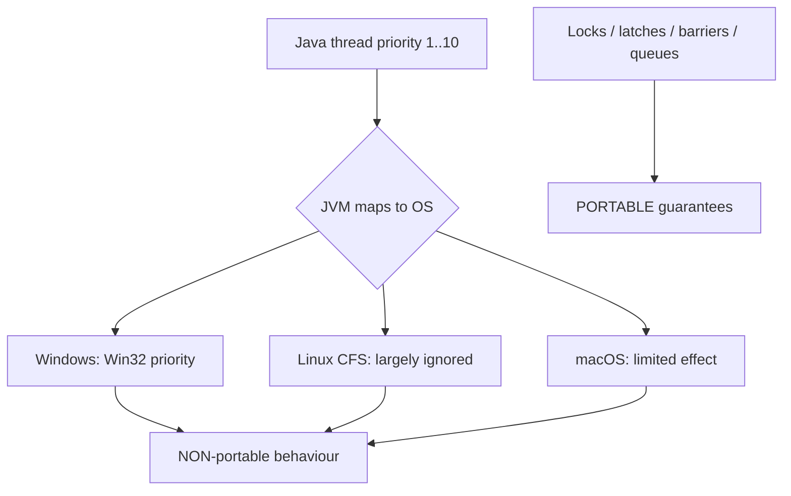

# 5. Are thread priorities guaranteed across all JVMs?

> **Section:** Thread Fundamentals · **Level:** Architect / Tech Lead · **Related code:** `src/com/java/javathread/ThreadExample6.java`

## TL;DR

No. The Java specification only says priorities are a *scheduling hint*; it gives **no guarantee** that a higher-priority thread executes before, or more frequently than, a lower-priority one. The actual effect depends on the JVM implementation **and** the host OS. On many systems (notably mainstream Linux builds) thread priorities are effectively ignored.

## Deep Dive

### The JLS says "may"

The `Thread` Javadoc states the scheduler *may* prefer higher-priority threads, but that behaviour is **implementation-dependent**. Because Java threads map 1:1 to native OS threads, priority translation is lossy:

- **Windows**: priorities are mapped onto Win32 priority classes — visible but coarse.
- **Linux**: the default CFS scheduler largely ignores nice-style priority differences for normal (non-realtime) threads.
- **macOS**: priorities have limited and inconsistent effect.

### So what *is* portable?

| Mechanism | Guaranteed? |
| --- | --- |
| `setPriority` | No |
| `synchronized` / locks | Yes (mutual exclusion) |
| `CountDownLatch` / `CyclicBarrier` | Yes (ordering/synchronization) |
| `BlockingQueue` ordering | Yes (FIFO/priority queue) |
| `ReentrantLock(true)` fairness | Yes (as documented) |

## Diagram



## Code Walkthrough

The lesson is best seen as an *anti-pattern*: relying on this to reorder output is unsafe.

```java
// Anti-pattern — do NOT rely on this ordering
Thread low  = new Thread(() -> System.out.println("low"));
Thread high = new Thread(() -> System.out.println("high"));
low.setPriority(Thread.MIN_PRIORITY);
high.setPriority(Thread.MAX_PRIORITY);
low.start();
high.start();   // "high" is *likely* but NOT guaranteed to print first
```

The repository's `ThreadExample6` deliberately does **not** use priorities, reinforcing that portability comes from structure, not hints.

## Architect / Tech-Lead Insights

- If you need priority-like behaviour, model it explicitly: a single-threaded executor with a `PriorityBlockingQueue`, or two distinct pools with different sizing/quotas.
- For latency-critical paths, prefer dedicated threads/pools over priority tweaks.
- Document any priority use as a *best-effort optimisation*, never as a correctness assumption.

## Common Pitfalls

| Pitfall | Why it hurts | Fix |
| --- | --- | --- |
| Porting code that assumes priority semantics | Silent behaviour change across OS/JVM | Use portable primitives |
| Using priority for QoS | Unreliable | Dedicated pools / queues |
| Testing flakiness | Ordering never guaranteed | Synchronize deterministically (latches) |

## Interview Q&A

**Q:** Does the JLS guarantee priority ordering?
**A:** No — it explicitly leaves scheduling to the implementation.

**Q:** What is the portable alternative?
**A:** Explicit synchronization: locks, latches, barriers, and blocking queues.

## Related Questions

- [4. What is the difference between thread priority levels?](4.What%20is%20the%20difference%20between%20thread%20priority%20levels.MD)
- [147. What is fairness in thread scheduling?](../8.%20Performance%20and%20Debugging/README.md#147-what-is-fairness-in-thread-scheduling)
