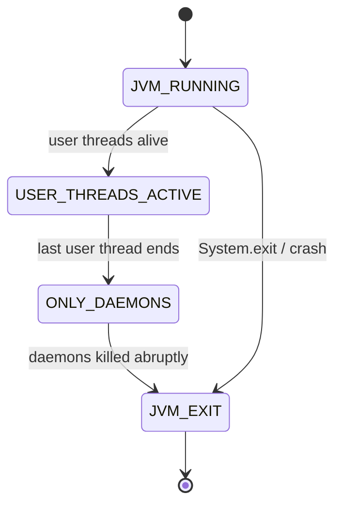

# 6. What is the difference between user threads and daemon threads?

> **Section:** Thread Fundamentals · **Level:** Architect / Tech Lead · **Related code:** `src/com/java/multithreading/interview/questions/DaemonExample.java`, `DaemonThreadDemo.java`

## TL;DR

A **user** thread keeps the JVM alive; a **daemon** thread does not. When the last user (non-daemon) thread finishes, the JVM exits immediately and all remaining daemon threads are killed abruptly — without running `finally` blocks reliably. Daemon threads suit background *housekeeping* (monitoring, cache eviction) that is safe to lose; they must never own critical work, transactions, or I/O that needs clean shutdown.

## Deep Dive

### The survival rule

- The JVM runs until **all user threads** terminate.
- Daemon threads are ignored for that decision — they are "best effort".
- `Thread.isDaemon()` / `setDaemon(true)` control this; the flag is inherited from the creating thread.

### Where daemon status comes from

| Thread | Daemon? |
| --- | --- |
| `main` | User (non-daemon) |
| Threads you create in `main` | Inherit `main` → user, unless you set daemon |
| JVM GC, JIT compiler threads | Daemon |
| `ForkJoinPool.commonPool()` workers | Daemon |

## Diagram



## Code Walkthrough

`DaemonExample` contrasts a 2-second user thread with an infinite daemon:

```java
// src/com/java/multithreading/interview/questions/DaemonExample.java
Thread userThread = new Thread(() -> {
    try {
        System.out.println("User thread started");
        Thread.sleep(2000);
        System.out.println("User thread finished");
    } catch (InterruptedException ignored) {}
}, "UserThread");

Thread daemonThread = new Thread(() -> {
    while (true) {
        System.out.println("Daemon thread running...");
        try { Thread.sleep(500); } catch (InterruptedException ignored) {}
    }
}, "DaemonThread");

daemonThread.setDaemon(true);   // MUST be before start()
userThread.start();
daemonThread.start();
```

- The daemon loops forever but cannot keep the JVM alive once `main` (user) exits.
- `DaemonThreadDemo` shows the extreme case: a daemon that dies the instant `main` returns.

## Architect / Tech-Lead Insights

- Put shutdown-sensitive work (flushing buffers, committing offsets, closing sockets) on **user** threads or in a managed executor you explicitly shut down. Daemon threads may be terminated mid-operation.
- `Executors.defaultThreadFactory()` creates **user** threads — so a forgotten `ExecutorService` will keep the JVM alive (a common "why won't it exit?" cause). `ForkJoinPool.commonPool()` is daemon.
- At shutdown, prefer an explicit hook (`Runtime.addShutdownHook`, or `executor.shutdown()` + `awaitTermination`) over relying on daemon death.

## Common Pitfalls

| Pitfall | Why it hurts | Fix |
| --- | --- | --- |
| Setting daemon after `start()` | Throws `IllegalThreadStateException` | Set before `start()` |
| Daemon thread that must finish | Data loss / corrupt state | Use a user thread + shutdown hook |
| Forgetting to shut down a pool | JVM hangs on exit | `executor.shutdown()` |
| Daemon writing to disk | Killed mid-write | Do I/O on managed user threads |

## Interview Q&A

**Q:** Does setting daemon prevent a call to `finally`?
**A:** It can — the JVM may exit before `finally` runs. Never rely on `finally` in a daemon for durability.

**Q:** What does `main` inherit?
**A:** `main` is a user thread; new threads inherit user status unless daemonised.

## Related Questions

- [7. How do you create a daemon thread?](7.How%20do%20you%20create%20a%20daemon%20thread.MD)
- [8. What happens if all user threads finish but daemon threads remain?](8.What%20happens%20if%20all%20user%20threads%20finish%20but%20daemon%20threads%20remain.md)
