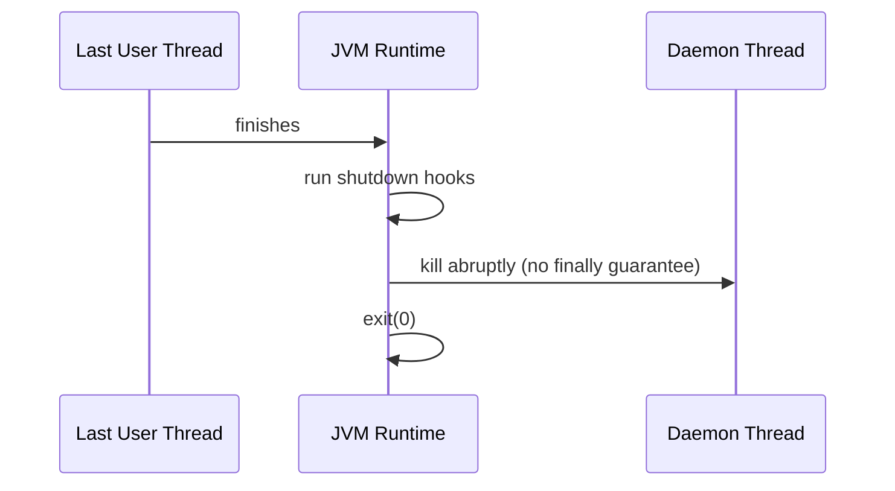

# 8. What happens if all user threads finish but daemon threads remain?

> **Section:** Thread Fundamentals · **Level:** Architect / Tech Lead · **Related code:** `src/com/java/multithreading/interview/questions/DaemonExample.java`, `DaemonThreadDemo.java`

## TL;DR

The JVM shuts down. As soon as the last **user** thread terminates, the runtime destroys the remaining **daemon** threads and exits — it does not wait for them. They are stopped abruptly, so `finally` blocks, buffer flushes, and commits may not complete.

## Deep Dive

### Shutdown sequence

1. Last user thread finishes (or `System.exit()` is called).
2. JVM runs registered **shutdown hooks**.
3. Daemon threads are terminated abruptly.
4. JVM process exits.

### What is NOT guaranteed for daemons

| Guarantee | Daemon thread |
| --- | --- |
| Runs `finally` | No |
| Flushes buffers | No |
| Completes in-flight I/O | No |
| Runs `join()` callbacks | No |

## Diagram



## Code Walkthrough

`DaemonThreadDemo` is the canonical demonstration — the daemon prints forever, but the process ends the moment `main` returns:

```java
// src/com/java/multithreading/interview/questions/DaemonThreadDemo.java
Thread t = new Thread(() -> {
    while (true) {
        System.out.println("Daemon running...");
        try { Thread.sleep(500); } catch (InterruptedException e) {}
    }
});
t.setDaemon(true);
t.start();
System.out.println("Main thread exiting");   // JVM exits right after this
```

In `DaemonExample`, `main` sleeps and `join()`s the **user** thread, so the daemon gets to run for a while — but it is still abandoned when `main` ends.

## Architect / Tech-Lead Insights

- This is precisely why **critical background work must be a user thread** or a managed executor you shut down explicitly.
- Use `Runtime.getRuntime().addShutdownHook(...)` for best-effort cleanup — but keep hooks short and never rely on them for durability (they may not run on `kill -9`).
- "App exits while a background job is half-done" is almost always a daemon-thread bug.

## Common Pitfalls

| Pitfall | Why it hurts | Fix |
| --- | --- | --- |
| Durable work on a daemon | Lost on exit | User thread + `join`/shutdown |
| Relying on `finally` in daemons | Not guaranteed | Explicit shutdown + awaitTermination |
| Assuming hooks always run | Skipped on SIGKILL/crash | Design for idempotent, crash-safe work |

## Interview Q&A

**Q:** Does the JVM wait for daemon threads?
**A:** No — it exits regardless of what they are doing.

**Q:** How do you ensure background work completes?
**A:** Run it on user threads (or a real executor) and wait via `join`/`awaitTermination` or a shutdown hook.

## Related Questions

- [6. What is the difference between user threads and daemon threads?](6.What%20is%20the%20difference%20between%20user%20threads%20and%20daemon%20threads.MD)
- [20. What are best practices for handling thread lifecycle?](20.%20What%20are%20best%20practices%20for%20handling%20thread%20lifecycle.md)
