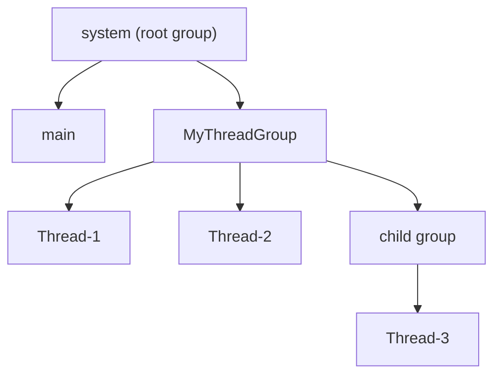

# 9. What are thread groups in Java?

> **Section:** Thread Fundamentals · **Level:** Architect / Tech Lead · **Related code:** `src/com/java/multithreading/interview/questions/ThreadGroupExample.java`

## TL;DR

A `ThreadGroup` is a container that lets you manage several threads as one unit — usually for bulk operations like `interrupt()`, enumerating live threads, setting a maximum priority, or installing a shared uncaught-exception handler. Every thread belongs to exactly one group, and groups can be nested in a parent/child hierarchy.

## Deep Dive

### Key characteristics

- Every `Thread` belongs to exactly one `ThreadGroup`.
- `new Thread(...)` inherits the group of the creating thread unless you pass a group explicitly.
- Groups nest: the root is the `"system"` group.
- A group can cap priorities via `setMaxPriority(int)`.
- Groups are **largely legacy** (see [question 10](10.%20Are%20thread%20groups%20recommended%20for%20modern%20applications.md)).

### Important methods

| Method | Description |
| --- | --- |
| `activeCount()` | Number of live threads in the group |
| `enumerate(Thread[])` | Copy live thread references into an array |
| `interrupt()` | Interrupt every thread in the group |
| `setMaxPriority(int)` | Cap priorities for the group |
| `uncaughtException(Thread, Throwable)` | Default handler for the group |
| `getParent()` | Parent group |

## Diagram



## Code Walkthrough

`ThreadGroupExample` creates a group, adds two threads, enumerates them, and interrupts the whole group:

```java
// src/com/java/multithreading/interview/questions/ThreadGroupExample.java
ThreadGroup group = new ThreadGroup("MyThreadGroup");
Thread t1 = new Thread(group, () -> { /* ... */ }, "Thread-1");
Thread t2 = new Thread(group, () -> { /* ... */ }, "Thread-2");
t1.start();
t2.start();
System.out.println("Active threads in group: " + group.activeCount());
Thread[] threads = new Thread[group.activeCount()];
group.enumerate(threads);
for (Thread t : threads) System.out.println("Thread in group: " + t.getName());
group.interrupt();   // interrupts ALL threads at once
```

1. Threads are created *inside* `group`.
2. `activeCount()` + `enumerate()` give a coarse monitoring view.
3. `interrupt()` broadcasts a cooperative cancellation signal to the whole group.

## Architect / Tech-Lead Insights

- The bulk `interrupt()` is the one feature that still appears in production — often to cancel a family of related worker threads.
- Modern equivalents are stronger: `ExecutorService.shutdownNow()` interrupts all pooled workers; structured concurrency scopes cancellation to a task tree.
- Thread-group monitoring is superseded by JMX, thread dumps, and `ThreadMXBean`.

## Common Pitfalls

| Pitfall | Why it hurts | Fix |
| --- | --- | --- |
| Relying on `activeCount()` for exact logic | It is an estimate | Use JMX / explicit coordination |
| Assuming `enumerate()` is a snapshot | Threads can appear/disappear | Re-check and treat as best-effort |
| Using groups for security sandboxing | Deprecated model | Use `SecurityManager`/container isolation |

## Interview Q&A

**Q:** How many groups can a thread belong to?
**A:** Exactly one.

**Q:** Can groups nest?
**A:** Yes, forming a hierarchy up to the `system` root.

## Related Questions

- [10. Are thread groups recommended for modern applications?](10.%20Are%20thread%20groups%20recommended%20for%20modern%20applications.md)
- [3. What are Thread Groups in Java and how are they used?](../3.%20What%20are%20Thread%20Groups%20in%20Java%20and%20how%20are%20they%20used.md)
