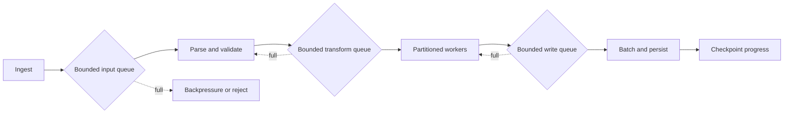

# 181. How would you design a high-throughput data pipeline in Java?

> **Section:** System Design Scenarios · **Level:** Architect / Tech Lead

## TL;DR

Design around the workload contract first: throughput, tail latency, ordering, durability, loss tolerance, and recovery time. Use bounded stages, explicit backpressure, partitioned parallelism where safe, and idempotent recovery. Measure each stage at saturation; adding threads cannot fix a slower downstream dependency.

## Design approach

Separate ingestion, CPU transforms, blocking I/O, and sink writes into stages with bounded queues. Choose partition keys that preserve only the ordering the product requires. Batch when it amortizes network or storage overhead without violating latency goals. Bound in-flight work and downstream connections; reject, defer, or shed load deliberately rather than letting queues grow without limit.

Checkpoint progress only after the corresponding effects are durable, or make sink writes idempotent so replay is safe. Record per-stage queue depth, utilization, throughput, latency, failure rate, retries, and checkpoint lag.

## Practical decisions

- Isolate blocking I/O from CPU-bound transformations; size each pool for its resource, not a single generic thread count.
- Preserve per-key order by routing a key consistently, not by globally serializing all work.
- Define what happens on overload and poison records; expose rejected, delayed, and dead-letter counts.
- Use bounded retries with backoff and a total deadline; replay only idempotent or deduplicated work.
- Load-test steady state, bursts, slow sinks, and recovery after worker or node loss.

## Pitfalls and decision checklist

- [ ] Queue capacities and maximum in-flight work are explicit.
- [ ] Ordering, durability, and duplicate-delivery semantics are documented.
- [ ] Checkpoints cannot advance ahead of durable side effects.
- [ ] Slow downstreams trigger controlled backpressure, not memory growth.
- [ ] Metrics identify the bottleneck and saturation point.

Avoid an unbounded executor queue, unbounded thread creation, and “exactly once” claims that ignore external side effects.

## Related

- [183. Designing concurrent batch processing](183.%20Designing%20concurrent%20batch%20processing.md)
- [184. Designing real-time streaming](184.%20Designing%20real-time%20streaming.md)
- [186. Designing retries](186.%20Designing%20retries.md)
- [187. Implementing timeouts](187.%20Implementing%20timeouts.md)
