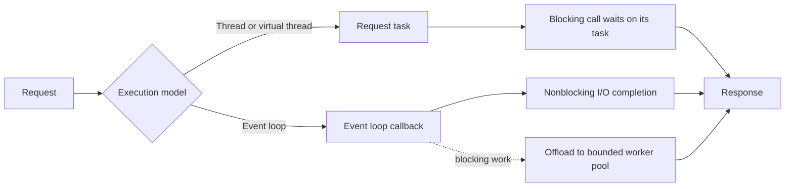

# 182. When to use thread-per-request vs event-loop model?

> **Section:** System Design Scenarios · **Level:** Architect / Tech Lead

## TL;DR

Thread-per-request keeps request code straightforward and is effective at moderate concurrency or when dependencies block. Java virtual threads make blocking-style I/O concurrency practical, but do not increase database or remote-service capacity. Event loops use few threads efficiently for many connections when the whole call path is nonblocking; a blocking callback can stall unrelated requests.

## Compare the models

| Concern | Thread per request | Event loop |
| --- | --- | --- |
| Control flow | Sequential and easy to follow | Async callbacks/state transitions |
| Blocking I/O | Natural; consumes a thread while waiting | Must be offloaded or replaced with nonblocking I/O |
| Scaling constraint | Thread/resource and downstream limits | Event-loop CPU and blocking callbacks |
| Best fit | Blocking libraries, simpler service logic | High connection counts and nonblocking stacks |

## Practical guidance

Measure concurrency, connection count, CPU, queueing, tail latency, and downstream saturation using representative traffic. Apply admission control and timeouts regardless of model. With virtual threads, still limit scarce resources such as database connections using pools or semaphores. With an event loop, audit every callback and library for blocking behavior and provide bounded offload capacity.

## Pitfalls and decision checklist

- [ ] The choice fits the blocking behavior of the complete dependency stack.
- [ ] Pool, event-loop, and downstream capacities are bounded.
- [ ] Cancellation and deadlines propagate across asynchronous boundaries.
- [ ] Blocking work cannot monopolize event-loop threads.
- [ ] Benchmarks include realistic I/O waits and tail latency.

Do not treat a large thread count or a small event-loop thread count as a performance target by itself.

## Related

- [181. Design a high-throughput Java data pipeline](181.%20Design%20a%20high-throughput%20Java%20data%20pipeline.md)
- [187. Implementing timeouts](187.%20Implementing%20timeouts.md)
- [196. How do you enforce concurrency best practices org-wide?](../11.%20Leadership%20and%20Review%20Skills/196.%20How%20do%20you%20enforce%20concurrency%20best%20practices%20org-wide.md)
