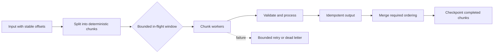

# 183. How do you design batch processing with concurrency?

> **Section:** System Design Scenarios · **Level:** Architect / Tech Lead

## TL;DR

Split work into deterministic chunks, limit the number in flight, and make each chunk idempotent or checkpointable. Preserve order only where required, aggregate all outcomes, and cap retries. Chunk size trades scheduling overhead against memory use, tail latency, and the cost of repeating failed work.

## Processing model

Give each chunk a stable identity and input range. Submit only a bounded window of chunks to a managed executor. Persist results and progress atomically where possible; otherwise use idempotency keys or a deduplication record. On partial failure, identify which chunks committed and retry only safe, failed units.

## Practical guidance

- Tune chunk size using throughput, p95/p99 latency, allocation, and recovery measurements.
- Bound both worker count and queued chunks; use backpressure or reject/defer new batches.
- Include stable chunk IDs, attempt counts, deadlines, and input offsets in diagnostics.
- Make merge behavior explicit: unordered completion is safe only if consumers do not depend on order.
- Shut down cooperatively and define what happens to in-flight chunks during cancellation.

## Pitfalls and decision checklist

- [ ] Chunk boundaries and identities are deterministic across restart.
- [ ] Output is idempotent, transactional, or deduplicated.
- [ ] Maximum in-flight work and retry attempts are bounded.
- [ ] Partial completion and ordering rules are explicit.
- [ ] Progress is checkpointed only after durable effects.

Avoid retrying an entire batch when only one non-idempotent chunk failed.

## Related

- [181. Design a high-throughput Java data pipeline](181.%20Design%20a%20high-throughput%20Java%20data%20pipeline.md)
- [186. Designing retries](186.%20Designing%20retries.md)
- [187. Implementing timeouts](187.%20Implementing%20timeouts.md)
