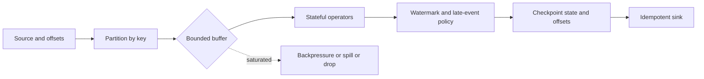

# 184. How do you design real-time streaming with concurrency?

> **Section:** System Design Scenarios · **Level:** Architect / Tech Lead

## TL;DR

Specify event-time versus processing-time semantics, partition ordering, lateness, retention, delivery guarantees, and acceptable lag before selecting a streaming engine. Bound buffers and define backpressure or an explicit drop/spill policy. Checkpoint source offsets and state consistently, and make sinks idempotent where replay can occur.

## Stream design

Partition by the key whose order matters. Track event-time watermarks and define how late events are handled (update, side output, or discard). Checkpoint offsets together with operator state so a restart resumes coherently. Treat “exactly once” as an end-to-end property: a framework checkpoint alone cannot make arbitrary external side effects exactly once.

## Operational guidance

Monitor consumer lag, watermark delay, queue occupancy, checkpoint duration/failures, late-event counts, retries, and sink latency. Test bursts, skewed keys, slow sinks, duplicate delivery, and restart from checkpoints. Scale partitions and consumers together while respecting per-key ordering and external capacity.

## Pitfalls and decision checklist

- [ ] Event-time and processing-time behavior are distinguished.
- [ ] Lateness, retention, ordering, and duplicate handling are specified.
- [ ] Buffer limits and overload behavior are explicit.
- [ ] Offset/state checkpoint consistency and sink replay behavior are tested.
- [ ] Lag and checkpoint health have actionable alerts.

Avoid silently dropping data when a queue fills; loss policy must be part of the contract.

## Related

- [181. Design a high-throughput Java data pipeline](181.%20Design%20a%20high-throughput%20Java%20data%20pipeline.md)
- [183. Designing concurrent batch processing](183.%20Designing%20concurrent%20batch%20processing.md)
- [186. Designing retries](186.%20Designing%20retries.md)
