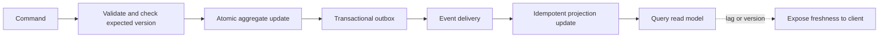

# 185. How do you apply CQRS with concurrency?

> **Section:** System Design Scenarios · **Level:** Architect / Tech Lead

## TL;DR

CQRS separates command handling from read-optimized projections; it does not itself solve concurrency. Protect each command's aggregate invariant with a transaction, version check, or serialized owner. Projections may lag, so make consistency visible and provide read-your-writes or reconciliation when the use case requires it.

## Command and projection flow

Validate commands at the authoritative write model and apply them atomically. Include an expected version when concurrent updates must not overwrite one another. Publish committed events via an outbox or equivalent reliable mechanism, then apply them idempotently to read models. Use event IDs or sequence numbers to detect duplicates and ordering gaps.

## Practical choices

- Use optimistic concurrency for independent updates and explicit conflict resolution for version mismatches.
- Serialize commands per aggregate only when that simplifies a real invariant and the throughput is adequate.
- Keep projection handlers replayable and make rebuilding read models an operationally tested process.
- If a client needs read-your-writes, return the committed version and let queries wait or route to authoritative state until the projection catches up.

## Pitfalls and decision checklist

- [ ] The write model owns invariants and has a defined concurrency-control rule.
- [ ] Events are emitted reliably after commit, not lost between database and broker.
- [ ] Projection updates are idempotent and ordering/version-aware.
- [ ] Eventual consistency and maximum expected lag are documented.
- [ ] Conflicts, retries, replay, and reconciliation have clear behavior.

Do not assume a thread-safe projection update makes the underlying command transaction correct.

## Related

- [186. Designing retries](186.%20Designing%20retries.md)
- [187. Implementing timeouts](187.%20Implementing%20timeouts.md)
- [193. What is a concurrency checklist for teams?](../11.%20Leadership%20and%20Review%20Skills/193.%20What%20is%20a%20concurrency%20checklist%20for%20teams.md)
