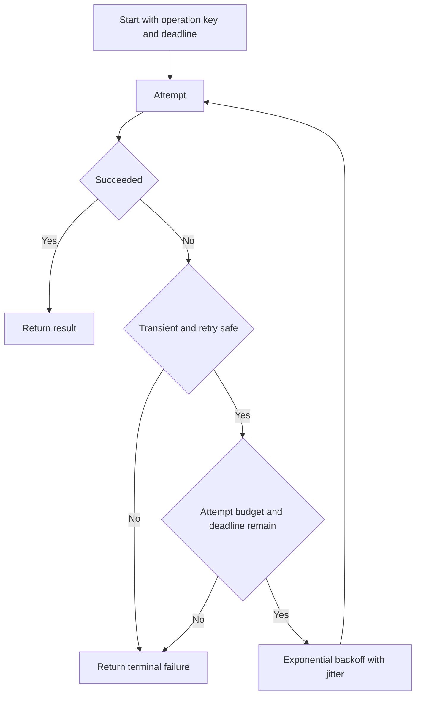

# 186. How do you design for retries in concurrent systems?

> **Section:** System Design Scenarios · **Level:** Architect / Tech Lead

## TL;DR

Retry only failures likely to be transient, and only when repeating the operation is safe through idempotency or deduplication. Bound attempts and total elapsed time, use exponential backoff with jitter, and enforce a retry budget. Coordinate layers so one logical request does not multiply attempts at every hop.

## Retry protocol

Give the logical operation an absolute deadline and an idempotency key where side effects may repeat. Classify errors: validation and permanent business failures are not retried; transient network errors or selected overload responses may be retried if the server contract allows it. Each attempt and its backoff must fit the remaining deadline. Honor server retry hints within the caller's remaining budget.

## Practical guidance

- Cap attempts, delay, and total elapsed time; randomize backoff to avoid synchronized retry bursts.
- Use a shared retry budget or rate limit when a dependency is degraded.
- Avoid independent retries in client, service, and transport layers; choose a clear owner for retry policy.
- Record logical request ID, attempt number, reason, delay, and final outcome.
- Do not retry non-idempotent writes unless an idempotency key is enforced durably by the receiver.

## Pitfalls and decision checklist

- [ ] Error classification and retry-safe operation semantics are explicit.
- [ ] All attempts plus backoff fit one propagated deadline.
- [ ] Attempts and aggregate retry volume are bounded.
- [ ] Jitter prevents synchronized client waves.
- [ ] Exhaustion, cancellation, and final error are observable.

Retries can amplify overload; add admission control and circuit breaking rather than retrying faster.

## Related

- [187. Implementing timeouts](187.%20Implementing%20timeouts.md)
- [188. What is a circuit breaker?](188.%20What%20is%20a%20circuit%20breaker.md)
- [183. Designing concurrent batch processing](183.%20Designing%20concurrent%20batch%20processing.md)
