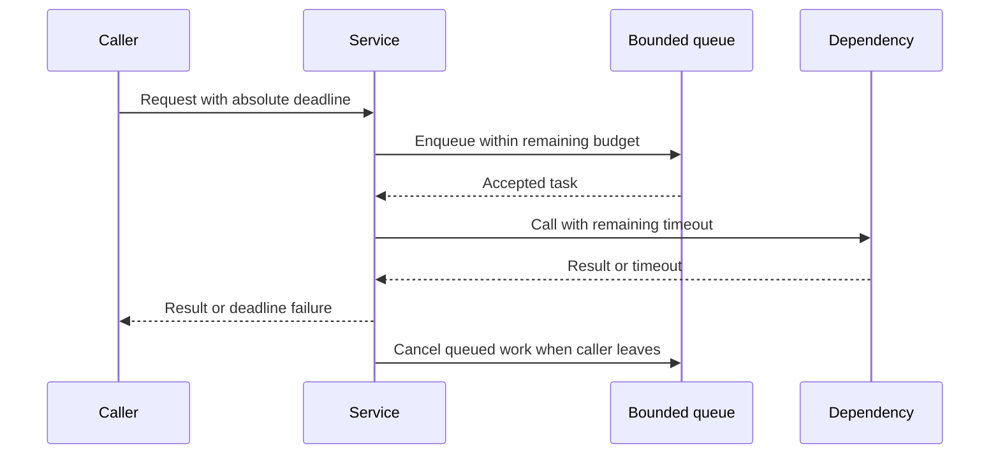

# 187. How do you implement timeouts in multithreaded systems?

> **Section:** System Design Scenarios · **Level:** Architect / Tech Lead

## TL;DR

Create one absolute request deadline and propagate it through every layer. Before each queue wait, lock acquisition, network operation, and join, derive the remaining budget; do not reset a full timeout at each hop. A timeout limits waiting, but does not guarantee underlying work stopped—propagate cancellation and release resources explicitly.

## Deadline propagation

Use a monotonic clock for elapsed-time calculations. Set a total deadline at ingress, reserve time for response/cleanup if needed, and pass the remaining budget downstream. Distinguish a caller timing out from confirmed task termination. Define whether partial results are valid and what happens if a timed-out side effect later completes.

## Practical guidance

- Bound queue acquisition, locks (`tryLock` with remaining time), socket/connect/read calls, futures, and shutdown waits.
- Recompute remaining time immediately before blocking; account for work already spent.
- Propagate interruption/cancellation and ensure cleanup is safe and idempotent.
- Avoid treating a timeout as proof that a remote server did not commit a write.
- Log deadline budget, elapsed time, phase, and whether cancellation was acknowledged.

## Pitfalls and decision checklist

- [ ] One end-to-end deadline is propagated across calls and retries.
- [ ] Every blocking boundary has a bounded wait.
- [ ] Timeout, cancellation, and task completion are separate states.
- [ ] Late completion and partial side-effect semantics are documented.
- [ ] Cleanup does not wait indefinitely.

Per-hop timeout resets can make total latency far exceed the advertised request budget.

## Related

- [186. Designing retries](186.%20Designing%20retries.md)
- [188. What is a circuit breaker?](188.%20What%20is%20a%20circuit%20breaker.md)
- [182. Thread-per-request versus event loop](182.%20Thread-per-request%20versus%20event%20loop.md)
