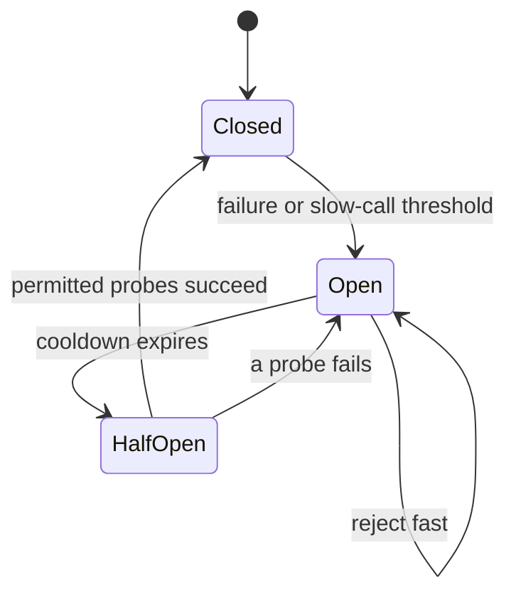

# 188. What is a circuit breaker pattern in concurrency?

> **Section:** System Design Scenarios · **Level:** Architect / Tech Lead

## TL;DR

A circuit breaker protects a caller from repeatedly invoking an unhealthy dependency. It typically transitions from **closed** (calls pass) to **open** (fail fast) after a configured failure/slow-call threshold, then to **half-open** for a limited number of probes. It complements—not replaces—timeouts, bulkheads, load shedding, and retry policy.

## State behavior

Count relevant failures over a defined window and use thresholds appropriate to traffic volume. In open state, reject quickly or use an explicitly safe fallback. After a cooldown, admit a small number of half-open probes; a successful recovery closes the breaker, while a failed probe reopens it. Ensure concurrent callers cannot all flood the dependency during recovery.

## Practical guidance

- Define which errors count, thresholds/window, cooldown, and half-open probe limit.
- Keep retries bounded and coordinated; retrying every breaker rejection defeats fast-fail behavior.
- Use bulkheads to isolate resource pools and timeouts to bound individual calls.
- Make fallback semantics explicit; stale or partial data may not be safe for every operation.
- Monitor state transitions, rejected calls, probe outcomes, and dependency latency.

## Pitfalls and decision checklist

- [ ] Failure classification excludes caller errors and other non-dependency failures.
- [ ] Calls have timeouts and bounded concurrency even while breaker is closed.
- [ ] Half-open probes are limited and recovery does not stampede.
- [ ] Fallback behavior is correct and observable.
- [ ] Metrics and alerts distinguish open-state protection from service success.

An open breaker is not evidence the dependency has recovered; only controlled probes should establish that.

## Related

- [186. Designing retries](186.%20Designing%20retries.md)
- [187. Implementing timeouts](187.%20Implementing%20timeouts.md)
- [181. Design a high-throughput Java data pipeline](181.%20Design%20a%20high-throughput%20Java%20data%20pipeline.md)
