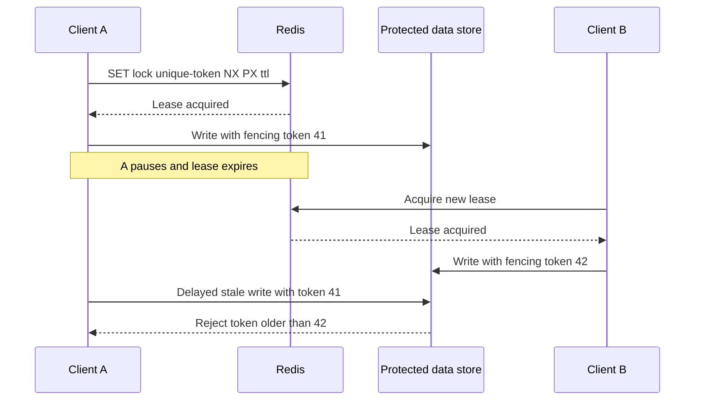

# 189. How do you design distributed locks using Redis?

> **Section:** System Design Scenarios · **Level:** Architect / Tech Lead

## TL;DR

For a simple Redis lease, acquire atomically with a unique owner token and expiry (for example, `SET key token NX PX ttl`); release only if the stored token still matches, using an atomic script. Renew only while ownership is confirmed. Expiration cannot stop a paused former owner from acting later: use monotonically increasing fencing tokens enforced by the protected resource when stale writes would violate correctness.

## Lease lifecycle

Set lease duration to cover expected work plus operational margin, but assume pauses, network partitions, and delayed responses can outlast it. A renewal response that is lost or denied means ownership is uncertain; stop protected work rather than assuming the lease remains valid. Token-checked release prevents one client from deleting a successor's lease.

## Correctness and operations

Redis lease ownership is not, by itself, a guarantee of exclusive effects across pauses and partitions. The resource being protected must remember the largest accepted fencing token and reject lower tokens. If the resource cannot enforce fencing, consider a database transaction/lock or another coordination model that matches the required consistency. Monitor acquisition failures, lease renewals, expirations, and owner identity without exposing secrets.

## Pitfalls and decision checklist

- [ ] Acquisition is atomic and has a finite TTL.
- [ ] Owner token is unique per acquisition; release is compare-and-delete.
- [ ] Renewal is bounded and uncertain renewal means stop acting.
- [ ] Stale owners are fenced at the protected resource when correctness requires it.
- [ ] Clock assumptions, Redis failover behavior, and failure policy are documented.

Do not rely on client clocks or “the old process should have noticed” to prevent stale writes.

## Related

- [190. Distributed coordination with ZooKeeper](190.%20Distributed%20coordination%20with%20ZooKeeper.md)
- [187. Implementing timeouts](187.%20Implementing%20timeouts.md)
- [193. What is a concurrency checklist for teams?](../11.%20Leadership%20and%20Review%20Skills/193.%20What%20is%20a%20concurrency%20checklist%20for%20teams.md)
