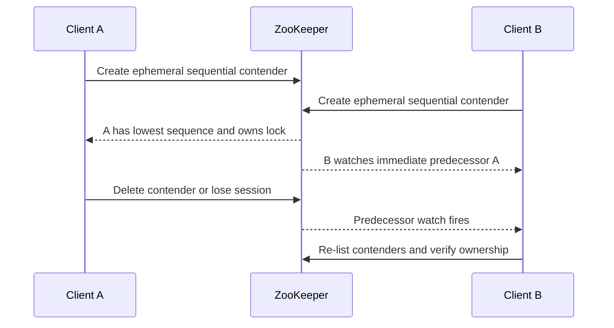

# 190. How do you implement distributed coordination with Zookeeper?

> **Section:** System Design Scenarios · **Level:** Architect / Tech Lead

## TL;DR

ZooKeeper provides ordered coordination using znodes, sessions, watches, and atomic operations. A common lock recipe creates an **ephemeral sequential** contender and waits on only its immediate predecessor; this avoids waking every waiter. Session expiration removes ephemeral ownership, but clients must treat session loss and reconnect as ownership loss and must guard protected resources against stale work.

## Lock recipe

Create a contender under a lock path with ephemeral and sequential flags. List contenders in sequence order: the lowest sequence owns the lock; each other client watches its immediate predecessor and retries the list after notification or connection changes. Watches are one-shot hints, not durable event streams—always re-read state. Remove the contender on release; session expiry also removes ephemeral nodes.

## Correctness and operations

Handle connection loss as an ambiguous outcome: the create may have succeeded even if its response was lost, so identify and clean up the client's own contender safely. On session expiration, stop acting as owner; reconnecting does not restore the old session's lock. For external writes, use fencing/epochs that the target validates, because a paused client can continue after losing its session. Keep coordination data small and avoid high-churn service discovery in the critical path.

## Pitfalls and decision checklist

- [ ] Lock nodes are ephemeral and sequential; contender identity is recoverable.
- [ ] A waiter watches only its predecessor and rechecks after every wakeup.
- [ ] Session loss means immediate ownership loss; reconnect starts a new attempt.
- [ ] Ambiguous create results and cleanup are handled idempotently.
- [ ] Protected resources reject stale owners where necessary.

Do not treat a watch notification as proof of ownership or assume it fires repeatedly.

## Related

- [189. Distributed locks with Redis](189.%20Distributed%20locks%20with%20Redis.md)
- [187. Implementing timeouts](187.%20Implementing%20timeouts.md)
- [196. How do you enforce concurrency best practices org-wide?](../11.%20Leadership%20and%20Review%20Skills/196.%20How%20do%20you%20enforce%20concurrency%20best%20practices%20org-wide.md)
