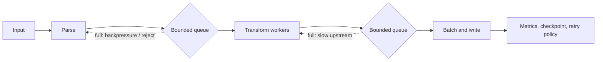
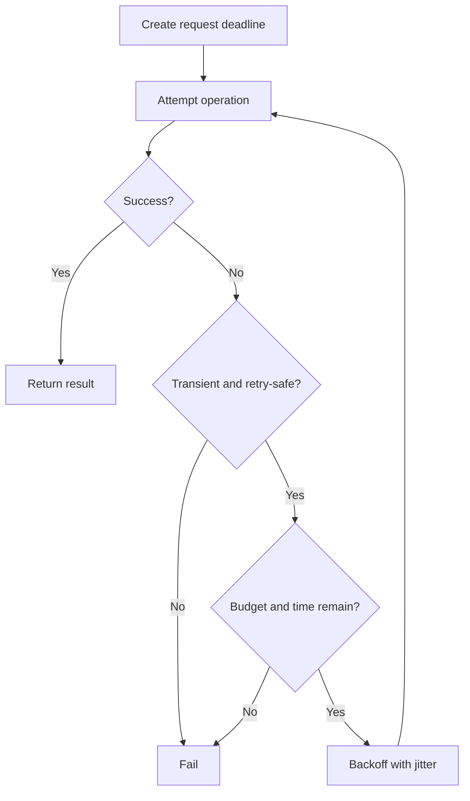
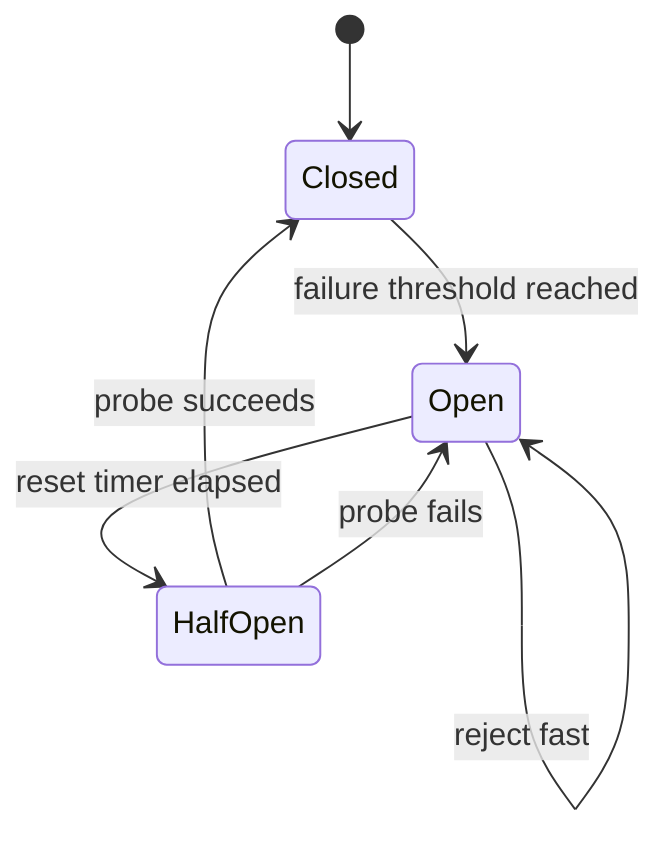

# 10. System Design Scenarios

> Complete guide to questions 181–190 in the [master index](../00-INDEX.md). Start with workload, correctness, and failure requirements; concurrency primitives are implementation details of the design.

## Answers

### 181. Design a high-throughput Java data pipeline

Define throughput, latency, ordering, durability, and loss requirements first. Use bounded stages with explicit queue capacities, batch where it reduces overhead, partition by key where ordering is needed, and isolate blocking I/O from CPU transforms. Add backpressure/admission control, idempotent recovery, metrics per stage, and load tests at saturation.

### 182. Thread-per-request versus event loop

Thread-per-request gives simple sequential code and works well when blocking calls are expected and concurrency is moderate; virtual threads extend its useful range for I/O-heavy work. Event loops can serve many connections with few threads but require nonblocking dependencies and strict avoidance of blocking callbacks. Consider complexity and downstream limits.

### 183. Designing concurrent batch processing

Partition input into deterministic chunks, bound in-flight chunks, and make each chunk idempotent or checkpointable. Preserve required order at merge, aggregate failures explicitly, and cap retries. Tune chunk size to amortize overhead without hurting tail latency or making recovery too costly.

### 184. Designing real-time streaming

Specify event time versus processing time, ordering key, lateness policy, delivery guarantees, and retention. Use bounded buffers and backpressure or an explicit drop/spill policy. Partition for parallelism, checkpoint offsets/state consistently, make sinks idempotent, and monitor lag, watermark, retries, and consumer saturation.

### 185. Applying CQRS with concurrency

CQRS separates command validation/state changes from read models optimized for queries. Commands need a concurrency-control rule (version check, transaction, or serialized aggregate owner); events update projections asynchronously, so reads may be eventually consistent. Expose version/lag where clients need read-your-writes or reconciliation.

### 186. Designing retries

Retry only transient failures and operations that are idempotent or protected by deduplication/idempotency keys. Use bounded attempts, exponential backoff with jitter, a total deadline, and retry budgets to prevent amplification. Avoid retrying at every layer independently; record attempt and terminal outcome.

### 187. Implementing timeouts

Use an absolute deadline propagated through the call tree, then derive each operation's remaining budget. Bound lock acquisition, queue waits, network calls, and task joins separately. A timeout stops waiting but may not stop underlying work; propagate cancellation and release resources, and define what partial results mean.

### 188. What is a circuit breaker?

A circuit breaker tracks failures or slow calls and transitions among closed, open, and half-open states. Open rejects or fails fast; half-open allows limited probes. It protects a caller from repeatedly loading a failing dependency but is not a substitute for timeouts, bulkheads, or retry policy.

### 189. Distributed locks with Redis

Acquire a lease using an atomic conditional set with a unique owner token and expiry; release only if the stored token still matches. Renew carefully and treat lease loss as loss of ownership. Expiration alone cannot stop a paused former owner from writing later: use fencing tokens enforced by the protected resource when correctness requires it.

### 190. Distributed coordination with ZooKeeper

ZooKeeper provides ordered, durable coordination primitives using znodes, watches, sessions, and atomic transactions. A common lock recipe uses ephemeral sequential nodes and waits on the immediate predecessor, avoiding a thundering herd. Session loss releases ephemeral ownership; clients must handle reconnects, watches as one-shot hints, and stale owners.

## Design diagrams

### Bounded pipeline and overload



### Retry within one deadline



### Circuit breaker states



### Distributed lease with fencing

```mermaid
sequenceDiagram
    participant A as Client A
    participant L as Lock service
    participant R as Protected resource
    participant B as Client B
    A->>L: Acquire lease; receive token 41
    A->>R: Write with fencing token 41
    L-->>A: Lease expires or session lost
    B->>L: Acquire new lease; receive token 42
    B->>R: Write with fencing token 42
    A->>R: Stale write with token 41
    R-->>A: Reject token older than 42
```

## Review checklist

- State the consistency, ordering, durability, and overload contracts before choosing a framework.
- Bound concurrency, queues, retries, and resource pools; load shedding must be intentional.
- Propagate deadlines and cancellation, and distinguish timeout from cancellation completion.
- For distributed coordination, assume pauses, partitions, duplicate delivery, and stale clients.
- Make operations idempotent or provide deduplication and fencing where required.
