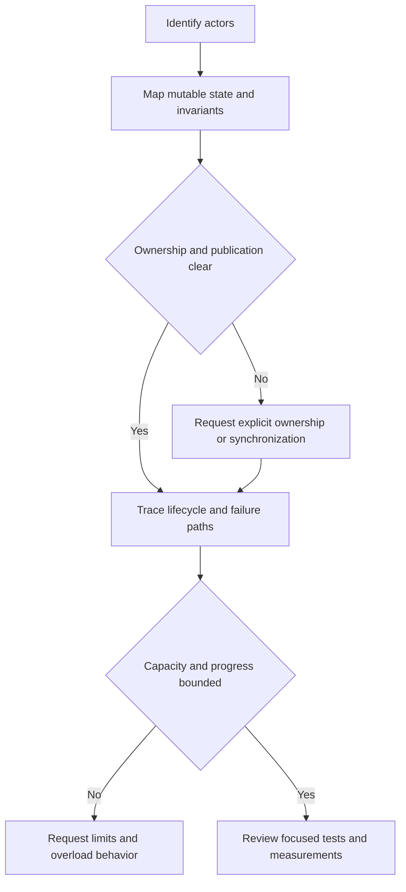

# 191. How do you review code for concurrency issues?

> **Section:** Leadership and Review Skills · **Level:** Architect / Tech Lead

## TL;DR

Review ownership and behavior, not just the presence of `synchronized`. Identify concurrent actors, shared mutable state, invariants, and the happens-before path for every cross-thread read/write. Then examine lifecycle, failure, capacity, progress, and evidence.

## Review sequence

1. Map tasks and shared values; include nested mutable objects and escaped collections.
2. Establish ownership: thread-confined, immutable after publication, guarded by one lock, or managed through a concurrent abstraction.
3. Trace state transitions and verify compound operations are atomic and visible.
4. Follow task submission through completion, exception, timeout, cancellation, interruption, and shutdown.
5. Check lock ordering, blocking calls, pool starvation, queue bounds, and retry safety.
6. Ask for focused tests and operational evidence; a passing test is evidence, not proof.

Do not request a lock just because a field is shared: immutable state may need only safe publication. Conversely, `volatile` does not make `count++` atomic.

## Pitfalls and decision checklist

- [ ] All accesses to relevant shared state follow the same synchronization policy.
- [ ] Safe publication and happens-before relationships are explained.
- [ ] Exceptions, cancellation, interruption, and cleanup are observable.
- [ ] Blocking, retries, pools, and queues have bounded behavior.
- [ ] Tests exercise adverse interleavings without depending on `sleep()`.

## Related

- [192. What are common concurrency code smells?](192.%20What%20are%20common%20concurrency%20code%20smells.md)
- [193. What is a concurrency checklist for teams?](193.%20What%20is%20a%20concurrency%20checklist%20for%20teams.md)
- [198. What are common concurrency pitfalls in code reviews?](198.%20What%20are%20common%20concurrency%20pitfalls%20in%20code%20reviews.md)
