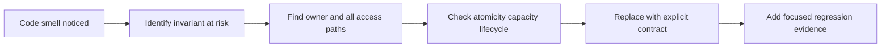

# 192. What are common concurrency code smells?

> **Section:** Leadership and Review Skills · **Level:** Architect / Tech Lead

## TL;DR

Concurrency smells are prompts to investigate, not automatic proof of a bug. For each one, ask what invariant is at risk, who owns the state, and what lifecycle/capacity contract is missing.

## Smells and safer questions

| Smell | Risk | Review question |
| --- | --- | --- |
| Shared mutable state with no policy | Data race or visibility bug | Who owns every access? |
| `volatile` on compound update | Lost updates | Is the whole invariant atomic? |
| Check-then-act across calls | Duplicate or inconsistent action | Can one atomic operation guard both steps? |
| Exposed mutable collection | Protection escapes | Can callers mutate it outside the boundary? |
| Ignored interrupt or task failure | Lost cancellation/failure | Where is the signal observed? |
| Unbounded threads, queues, or retries | Resource exhaustion | What is the bound and overload response? |
| I/O or callbacks under a lock | Deadlock and long contention | Can work happen outside the critical section? |
| Sleep-based tests | Timing-dependent evidence | Can coordination be deterministic? |

## Pitfalls and decision checklist

- [ ] The smell is tied to a concrete invariant or progress risk.
- [ ] The fix specifies ownership, synchronization, and handoff.
- [ ] Executor, queue, retry, timeout, and shutdown policies are bounded.
- [ ] Mutable values cannot escape their protection.
- [ ] Regression tests target the problematic interleaving or failure path.

Avoid blanket “add synchronization” changes: they can hide the issue, serialize unrelated work, or introduce deadlocks. Treat a smell as a prompt to investigate, not automatic evidence that the code is broken.

## Related

- [191. How do you review code for concurrency issues?](191.%20How%20do%20you%20review%20code%20for%20concurrency%20issues.md)
- [198. What are common concurrency pitfalls in code reviews?](198.%20What%20are%20common%20concurrency%20pitfalls%20in%20code%20reviews.md)
- [193. What is a concurrency checklist for teams?](193.%20What%20is%20a%20concurrency%20checklist%20for%20teams.md)
