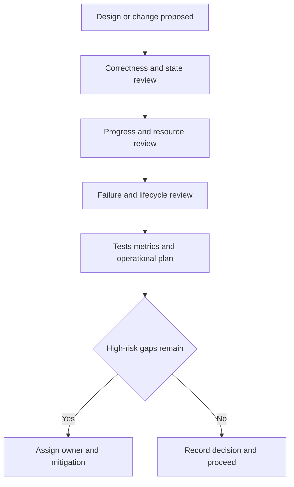

# 193. What is a concurrency checklist for teams?

> **Section:** Leadership and Review Skills · **Level:** Architect / Tech Lead

## TL;DR

A team checklist makes hidden concurrency assumptions reviewable and repeatable. Use it in design reviews, pull requests, and release readiness; mark items not applicable only with a clear reason, and assign owners to unresolved high-risk items.

## Checklist

### Correctness and state

- [ ] List threads/tasks that can access each mutable object.
- [ ] State invariants and the one consistent ownership/synchronization policy.
- [ ] Verify compound updates are atomic and cross-thread data is safely published.
- [ ] Keep state confined or immutable where practical; prevent mutable escape.

### Progress, resources, and failure

- [ ] Check lock ordering, callbacks under locks, blocking I/O, and starvation.
- [ ] Bound pools, queues, in-flight work, retries, and resource pools.
- [ ] Define overload, timeout, interruption, cancellation, exception, and shutdown behavior.
- [ ] Release resources on normal completion, failure, and cancellation.

### Verification and operations

- [ ] Test invariants and adverse paths deterministically; use stress tests where useful.
- [ ] Measure representative throughput and tail latency before accepting complexity.
- [ ] Provide diagnostics for queue growth, saturation, stuck work, and contention.
- [ ] Document assumptions, operational response, and risk owner.

## Pitfalls and decision checklist

- [ ] The checklist is tailored to the changed boundary, not blindly copied.
- [ ] Unchecked items have an owner, mitigation, and review date.
- [ ] “Thread-safe” claims cover composed operations and object graphs.
- [ ] Tests and metrics provide evidence for the stated contract.

The checklist is a conversation aid, not a substitute for understanding the design.

## Related

- [191. How do you review code for concurrency issues?](191.%20How%20do%20you%20review%20code%20for%20concurrency%20issues.md)
- [196. How do you enforce concurrency best practices org-wide?](196.%20How%20do%20you%20enforce%20concurrency%20best%20practices%20org-wide.md)
- [200. How do you document concurrency decisions for architecture?](200.%20How%20do%20you%20document%20concurrency%20decisions%20for%20architecture.md)
