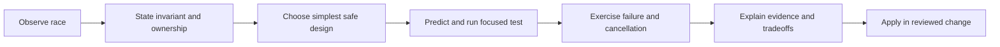

# 194. How do you teach concurrency to juniors?

> **Section:** Leadership and Review Skills · **Level:** Architect / Tech Lead

## TL;DR

Teach observable ideas in sequence, starting with a concrete race and the invariant it violates. Build from ownership and safe publication to standard primitives, then include cancellation, bounded capacity, failure, testing, and operations from the beginning.

## Teaching sequence

Start with two threads incrementing a shared counter and draw an interleaving that loses an update. Ask learners to describe ownership and the invariant before choosing a fix. Compare confinement, immutability, synchronization, atomics, and concurrent collections against the actual requirement. Introduce happens-before using locks, `volatile`, executor handoff/completion, and concurrent queues.

Have learners predict behavior, reproduce a bug, write a focused test, and explain what the test proves and does not prove. Extend the example with interruption, cancellation, timeout, bounded queues, and shutdown. Use thread dumps or profiling only after learners understand the behavior being observed.

## Pitfalls and mentoring checklist

- [ ] Use a small example connected to real code or service behavior.
- [ ] Ask the learner to explain a specific interleaving in their own words.
- [ ] Teach the simplest suitable abstraction, not a catalogue of primitives.
- [ ] Include lifecycle, boundedness, and failure handling.
- [ ] Praise sound reasoning and identify one actionable next concept.

Avoid presenting a successful test run as proof that a concurrent design is correct. Also avoid jumping directly to complex primitives before the learner can state the invariant, or taking ownership of the fix away from them.

## Related

- [199. How do you mentor developers on concurrency?](199.%20How%20do%20you%20mentor%20developers%20on%20concurrency.md)
- [191. How do you review code for concurrency issues?](191.%20How%20do%20you%20review%20code%20for%20concurrency%20issues.md)
- [193. What is a concurrency checklist for teams?](193.%20What%20is%20a%20concurrency%20checklist%20for%20teams.md)
