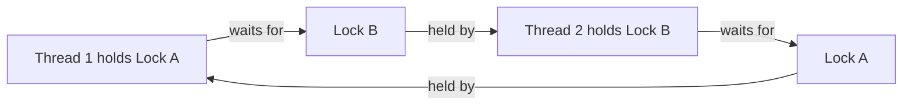

# 195. How do you explain deadlocks simply?

> **Section:** Leadership and Review Skills · **Level:** Architect / Tech Lead

## TL;DR

A deadlock is a standstill: each participant waits for a resource held by another, and no participant can progress to release what it holds. For two threads, each holding one lock and waiting for the other's lock creates a cycle.

## Explain prevention and diagnosis

Use the two-lock example to make the cycle visible, then show how both threads acquiring locks in one global order breaks the cycle. Prefer fewer nested locks and avoid calling unknown code, callbacks, or blocking I/O while holding a lock. Timed `tryLock` can bound waiting in designs that can safely recover, but it does not make an inconsistent locking protocol safe.

In production, inspect thread dumps and lock ownership. Distinguish deadlock from slow I/O, starvation, or a thread blocked on work scheduled to the same exhausted executor.

## Pitfalls and decision checklist

- [ ] Locks have a consistent global acquisition order.
- [ ] Critical sections are short and do not include I/O or callbacks.
- [ ] Waiting is not confused with deadlock without evidence of a cycle.
- [ ] Recovery from timed lock failure preserves invariants.
- [ ] Thread dumps and ownership data are available in operations.

Avoid “fixing” a deadlock by adding timeouts without deciding what partially acquired work should do.

## Related

- [191. How do you review code for concurrency issues?](191.%20How%20do%20you%20review%20code%20for%20concurrency%20issues.md)
- [192. What are common concurrency code smells?](192.%20What%20are%20common%20concurrency%20code%20smells.md)
- [198. What are common concurrency pitfalls in code reviews?](198.%20What%20are%20common%20concurrency%20pitfalls%20in%20code%20reviews.md)
