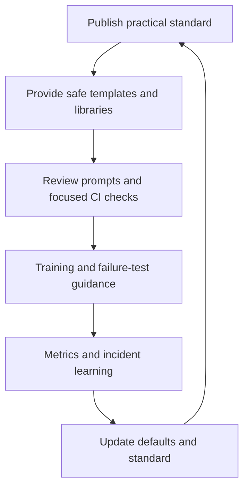

# 196. How do you enforce concurrency best practices org-wide?

> **Section:** Leadership and Review Skills · **Level:** Architect / Tech Lead

## TL;DR

Make the safe path the easy path. Combine a small set of explained standards with reusable defaults, targeted static checks, review prompts, training, failure testing, and production observability. A policy document alone is not enforcement; exceptions need an escalation path and a written rationale.

## Adoption model

Standardize managed executors with explicit capacity, immutable messages, ownership boundaries, cancellation and shutdown conventions, and approved shared-state abstractions. Supply templates or libraries only when they remove error-prone repetition without concealing policy. Add CI checks for concrete hazards such as ignored interruption or unsafe raw-thread creation, but tune rules to avoid noisy false positives.

## Leadership practices

Measure adoption, queue saturation, stuck work, latency, and concurrency-related incidents. Use blameless incident reviews to improve defaults, tests, training, and observability. Allow exceptional designs when justified; record the risk, owner, mitigation, and conditions for reconsideration.

## Pitfalls and decision checklist

- [ ] Standards explain rationale and show working examples.
- [ ] Defaults include bounds, lifecycle, cancellation, and observability.
- [ ] Automated rules target concrete hazards and are maintained.
- [ ] Teams have support and an escalation path for exceptions.
- [ ] Adoption and outcomes inform revisions.

Avoid treating compliance or a policy page as proof of safer production behavior.

## Related

- [193. What is a concurrency checklist for teams?](193.%20What%20is%20a%20concurrency%20checklist%20for%20teams.md)
- [194. How do you teach concurrency to juniors?](194.%20How%20do%20you%20teach%20concurrency%20to%20juniors.md)
- [200. How do you document concurrency decisions for architecture?](200.%20How%20do%20you%20document%20concurrency%20decisions%20for%20architecture.md)
