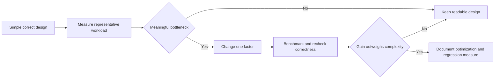

# 197. How do you balance readability vs performance in threaded code?

> **Section:** Leadership and Review Skills · **Level:** Architect / Tech Lead

## TL;DR

Start with the simplest correct design—often confinement, immutable data, or a standard executor. Optimize only after representative profiling identifies a meaningful bottleneck. Concurrency adds scheduling, coordination, memory, and operational costs; more threads do not automatically improve throughput or tail latency.

## Evidence-led optimization

State the target metric and workload, including contention, traffic shape, and p95/p99 latency. Profile the whole system for CPU, blocking, allocation, queueing, and downstream limits. Change one design choice at a time and benchmark with realistic data, warm-up, and repeated runs. Keep explicit ownership and invariants; accept complexity only when measured gains justify maintenance cost.

## Pitfalls and decision checklist

- [ ] The target metric and workload are explicit.
- [ ] Measurements include contention, tail latency, queueing, and downstream effects.
- [ ] One change is evaluated at a time with repeatable evidence.
- [ ] Ownership, invariants, and failure semantics remain reviewable.
- [ ] Complexity and the reason for retaining it are documented.

Avoid adopting clever lock-free code based only on theoretical throughput or a narrow microbenchmark.

## Related

- [191. How do you review code for concurrency issues?](191.%20How%20do%20you%20review%20code%20for%20concurrency%20issues.md)
- [193. What is a concurrency checklist for teams?](193.%20What%20is%20a%20concurrency%20checklist%20for%20teams.md)
- [200. How do you document concurrency decisions for architecture?](200.%20How%20do%20you%20document%20concurrency%20decisions%20for%20architecture.md)
