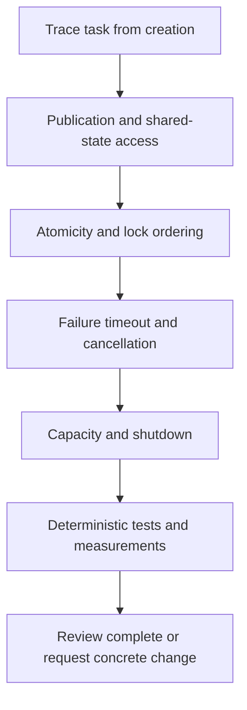

# 198. What are common concurrency pitfalls in code reviews?

> **Section:** Leadership and Review Skills · **Level:** Architect / Tech Lead

## TL;DR

Review the whole protocol—creation, publication, use, failure, cancellation, and cleanup—not only the new critical section. Common misses include incomplete synchronization, unsafe compound operations, escaped mutable state, unbounded capacity, lost failures, and tests that depend on timing.

## Review walkthrough

Trace one realistic adverse interleaving. Check that `volatile` is not being used for a read-modify-write invariant, a concurrent collection is not mistaken for an atomic multi-step workflow, and nested mutable values do not escape. Follow submitted tasks to observed completion and confirm they cannot outlive their request or service indefinitely. Check blocking waits against executor capacity and verify interruption and shutdown behavior.

## Pitfalls and decision checklist

- [ ] Synchronization covers all accesses and the complete invariant.
- [ ] Mutable object graphs are protected, not just the collection container.
- [ ] Future failures are observed; blocking cannot exhaust the completing pool.
- [ ] Locks do not cover callbacks or I/O; lock order is consistent.
- [ ] Retries, queues, waits, and shutdown are bounded.
- [ ] Tests coordinate deterministically and performance claims use realistic measurements.

Ask the author to explain a specific adverse interleaving rather than leaving vague “thread-safe?” feedback.

## Related

- [191. How do you review code for concurrency issues?](191.%20How%20do%20you%20review%20code%20for%20concurrency%20issues.md)
- [192. What are common concurrency code smells?](192.%20What%20are%20common%20concurrency%20code%20smells.md)
- [193. What is a concurrency checklist for teams?](193.%20What%20is%20a%20concurrency%20checklist%20for%20teams.md)
