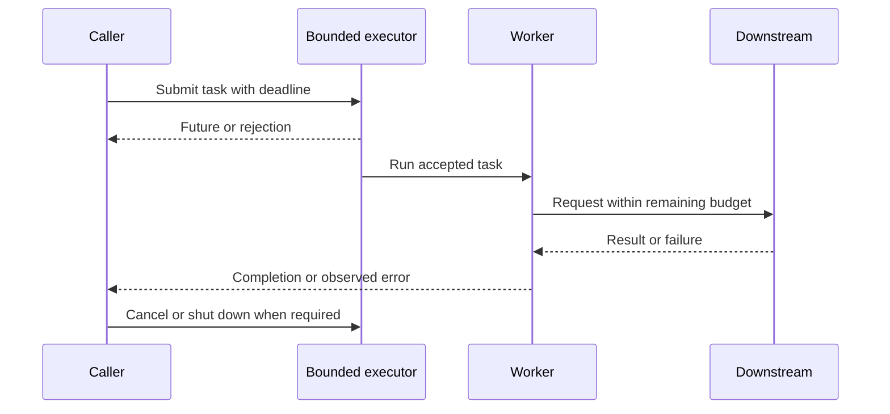

# 200. How do you document concurrency decisions for architecture?

> **Section:** Leadership and Review Skills · **Level:** Architect / Tech Lead

## TL;DR

Document the concurrency contract, not simply “uses threads” or “uses a lock.” A concise architecture decision record (ADR) should explain workload goals, actors and state ownership, capacity, lifecycle/failure semantics, alternatives, operational evidence, and who will revisit the decision.

## ADR contents

- **Context and goals:** workload, throughput/latency targets, and constraints.
- **Model and capacity:** actors/tasks, executor or scheduler, parallelism, queue bounds, overload behavior.
- **Correctness:** shared state, owner, invariants, synchronization, and publication/handoff.
- **Lifecycle and failure:** cancellation, interruption, deadlines, retries, exceptions, cleanup, and shutdown order.
- **Trade-offs:** alternatives and their costs, such as ordering, contention, complexity, or availability.
- **Operations and verification:** metrics, alerts, tests, benchmark evidence, saturation behavior, and stall diagnosis.
- **Ownership:** decision owner, invalidating conditions, and review date.

Use diagrams to make async boundaries and lifecycle states obvious, then update them when implementation changes.

## Pitfalls and decision checklist

- [ ] The decision names owners, invariants, limits, and overload response.
- [ ] Deadline, retry, cancellation, interruption, and shutdown contracts are explicit.
- [ ] Alternatives and measured trade-offs are captured.
- [ ] Tests, metrics, alerts, and diagnosis guidance are discoverable.
- [ ] An owner and reconsideration trigger/date are assigned.

Avoid stale diagrams and undocumented assumptions; keep the ADR close to the architecture materials maintainers use. Do not record only the primitive name (“uses a lock”) without its owner, invariant, scope, and failure behavior.

## Related

- [193. What is a concurrency checklist for teams?](193.%20What%20is%20a%20concurrency%20checklist%20for%20teams.md)
- [196. How do you enforce concurrency best practices org-wide?](196.%20How%20do%20you%20enforce%20concurrency%20best%20practices%20org-wide.md)
- [191. How do you review code for concurrency issues?](191.%20How%20do%20you%20review%20code%20for%20concurrency%20issues.md)
