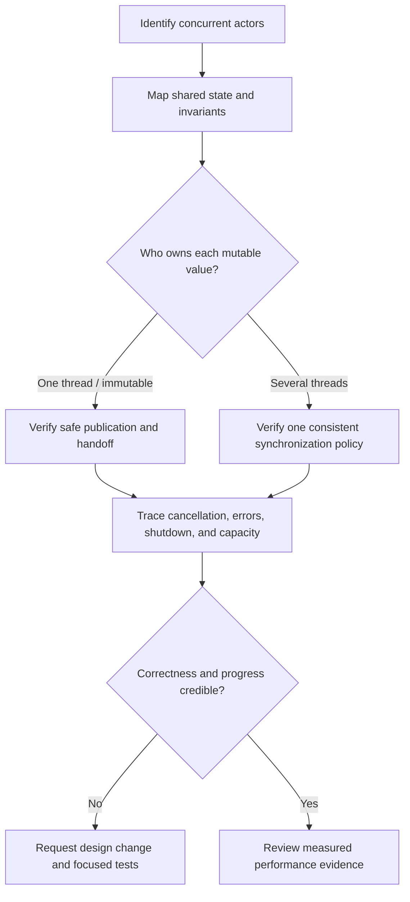
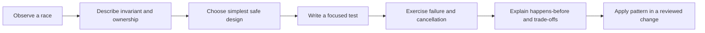
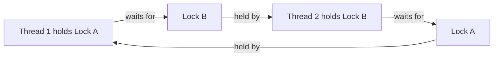
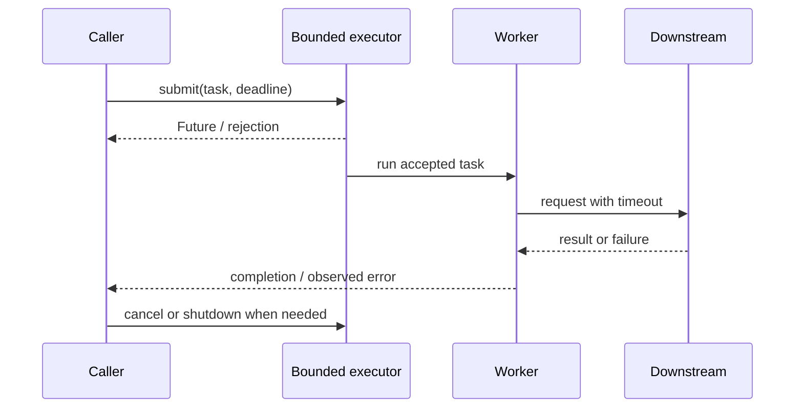

# 11. Leadership and Review Skills

> Questions 191–200 of the [master index](../00-INDEX.md).

Concurrency leadership is about making correctness assumptions explicit, reducing the number of places that need reasoning, and measuring before optimizing. Prefer clear ownership and well-understood abstractions over clever synchronization.

## 191. How do you review code for concurrency issues?

Review the behavior and ownership model, not just whether the code contains `synchronized`. Begin by identifying the concurrent actors, shared mutable state, and the invariants that must always hold. Then follow each state transition across threads and ask how one thread's writes become visible to another.

Review in this order:

1. **Find the boundary.** Which tasks can run concurrently? Which objects, collections, counters, caches, or lifecycle flags cross those boundaries?
2. **Establish ownership.** Is state thread-confined, immutable after publication, protected by one lock, or accessed through a concurrent abstraction? Is that policy consistent for every access?
3. **Check atomicity and visibility.** Can a multi-step operation interleave? Is there a happens-before edge (for example, monitor unlock/lock, `volatile`, `java.util.concurrent` handoff, or task completion) for the data being read?
4. **Trace lifecycle and failure.** Are tasks submitted to a bounded, managed executor? Are exceptions observed? Can cancellation, shutdown, interruption, timeout, or partial failure leave state inconsistent or work running indefinitely?
5. **Inspect progress and capacity.** Could lock ordering deadlock? Could blocking I/O starve a pool? Can a queue grow without limit? Are retries bounded and safe to repeat?
6. **Look for evidence.** Ask for focused tests and, where relevant, a small stress test, thread dump, profiler result, or benchmark. A passing test is evidence, not a proof of thread safety.

Do not request a lock merely because a field is shared: first determine whether it is mutable and what invariant needs protection. Conversely, `volatile` makes individual reads/writes visible but does not make compound operations such as `count++` atomic.

## 192. What are common concurrency code smells?

Treat these as prompts to investigate, not automatic proof of a defect:

- Mutable fields accessed from multiple threads with no documented owner or synchronization policy.
- `volatile` used to guard a read-modify-write operation, or a lock used on some but not all accesses to the same state.
- A check-then-act sequence (`if (!map.containsKey(k)) map.put(k, v)`) that is not atomic.
- Publicly exposed mutable collections, arrays, or objects that escape their lock or thread boundary.
- Manual `wait`/`notify` protocols, especially without a `while` condition loop, a clear predicate, or a consistent monitor.
- Catching and ignoring `InterruptedException`, swallowing task exceptions, or using `Thread.stop()`.
- Creating raw threads per request, unmanaged executors, unbounded queues, or executors that are never shut down.
- Holding a lock during I/O, callbacks, logging with unknown behavior, or calls into code that may acquire other locks.
- Nested locks acquired in inconsistent orders, or synchronized methods whose lock scope is broader than necessary.
- Fire-and-forget futures, unbounded retries, blocking on a future from a constrained executor, or asynchronous APIs that hide blocking work.
- Tests that rely on `sleep()` for coordination, or benchmarks that omit contention, warm-up, realistic load, or tail latency.

Replace each smell with a clear contract: ownership, synchronization boundary, executor and queue policy, cancellation behavior, and a test that exercises the relevant interleaving.

## 193. What is a concurrency checklist for teams?

Use this checklist in design reviews and code reviews. Mark an item not applicable only when the reason is clear.

### Correctness and state

- [ ] List the threads/tasks that can access each mutable object.
- [ ] State each invariant and the single synchronization/ownership policy that protects it.
- [ ] Ensure compound state changes are atomic; do not assume `volatile` makes a sequence atomic.
- [ ] Verify safe publication and the happens-before edge for cross-thread data.
- [ ] Keep mutable state confined where practical; prefer immutable values and defensive boundaries.
- [ ] Check that collections and nested objects do not escape their protection.

### Progress, resources, and failure

- [ ] Check lock ordering, lock scope, callbacks under locks, and blocking operations.
- [ ] Bound pools, queues, retries, and in-flight work; define overload/backpressure behavior.
- [ ] Define timeout, cancellation, interruption, exception propagation, and shutdown behavior.
- [ ] Ensure resources are released on normal completion, failure, and cancellation.
- [ ] Verify that waiting or blocking cannot starve the executor needed to make progress.

### Verification and operations

- [ ] Add deterministic tests for invariants and coordination; avoid sleeps as synchronization.
- [ ] Exercise contention, cancellation, failure, and shutdown paths; use stress testing where useful.
- [ ] Measure throughput and tail latency under representative load before accepting complexity.
- [ ] Provide enough metrics and diagnostics to identify queue growth, saturation, stuck tasks, and contention.
- [ ] Document assumptions, ownership, limits, and the operational response to saturation.

For release readiness, assign an owner to every unchecked high-risk item and record the mitigation or accepted risk.

## 194. How do you teach concurrency to juniors?

Teach a sequence of small, observable ideas rather than starting with a catalogue of locks:

1. Start with a concrete race: two threads incrementing the same counter, then explain the interleaving that loses an update.
2. Introduce the invariant and ownership first; compare thread confinement and immutable data with shared mutable state.
3. Explain visibility and happens-before through a few mechanisms learners will actually use: executor submission/completion, locks, `volatile`, and concurrent queues.
4. Show the standard tools (`ExecutorService`, `Future`/`CompletableFuture`, concurrent collections, atomics, locks) and when each is appropriate.
5. Include interruption, cancellation, timeouts, shutdown, and bounded capacity from the beginning—not as afterthoughts.
6. Have learners reproduce a bug, fix it, write a test, inspect a thread dump, and explain why the fix works.

Use runnable examples and ask learners to predict outcomes before execution. Avoid implying that one successful run proves correctness; discuss interleavings and what evidence a test can and cannot provide.

## 195. How do you explain deadlocks simply?

A deadlock is a standstill: each participant is waiting for something that another participant will not release. A familiar example is two people each holding one resource and waiting for the resource held by the other.

For two threads and two locks, the cycle means neither can proceed. Prevent common lock deadlocks by acquiring locks in one global order, reducing nested locking, and not calling unknown or blocking code while holding a lock. Where appropriate, timed `tryLock` can make waiting bounded, but it does not replace a sound design. Diagnose production incidents with thread dumps and lock-ownership information; distinguish deadlock from a slow operation, starvation, or a thread waiting for external I/O.

## 196. How do you enforce concurrency best practices org-wide?

Make the safe path the easy path. Publish a small set of approved patterns: managed executors with explicit capacity, immutable messages, clear ownership, standard cancellation/shutdown conventions, and safe shared-state abstractions. Provide reusable libraries or templates where they remove repeated error-prone mechanics without hiding important policy.

Support those patterns with:

- Short standards and examples that explain the reason behind each rule.
- Architecture and code-review prompts for shared state, capacity, lifecycle, and failure behavior.
- Static analysis and CI checks for concrete hazards (for example, ignored interruption or unsafe thread creation), tuned to avoid noisy blanket rules.
- Load, stress, and failure testing guidance plus production metrics for saturation, queue depth, latency, and stuck work.
- Incident reviews that improve libraries, defaults, training, and observability rather than merely assigning blame.

Give teams an escalation path for exceptional designs, require a written rationale for deviations, and revisit standards as workloads and JVM capabilities evolve. Measure adoption and incident patterns; do not confuse a policy document with enforcement.

## 197. How do you balance readability vs performance in threaded code?

Start with the simplest correct design—often confinement, immutable data, or a well-understood executor and concurrent collection. Optimize only after representative profiling identifies a meaningful bottleneck. Concurrency can improve throughput or latency, but it also adds scheduling, coordination, memory, and operational costs; more threads do not automatically mean more performance.

When optimization is justified:

- State the target metric and workload, including contention and tail latency.
- Change one design choice at a time and benchmark with realistic data, warm-up, and enough repetitions.
- Preserve explicit ownership and invariants; avoid clever lock-free code unless the gain is measured and the implementation can be maintained.
- Compare the whole system, including queueing, allocation, blocking, and downstream limits—not just a microbenchmark.
- Record the result and the reason for keeping complexity; add regression measurements where practical.

Prefer an understandable optimization with evidence over a theoretical optimization that makes correctness difficult to review.

## 198. What are common concurrency pitfalls in code reviews?

Common review misses include looking only at newly added synchronization instead of all accesses to the shared state; accepting `volatile` for a compound operation; overlooking mutable objects reachable through a thread-safe collection; and assuming a concurrent collection makes a multi-operation workflow atomic.

Also check for:

- A task that can outlive its request or service because cancellation and executor shutdown are unspecified.
- A future whose failure is never observed, or a blocking `get()`/`join()` that can exhaust the same pool needed to finish it.
- Lock inversion, callbacks while holding locks, and broad lock scopes that include I/O.
- Lost interrupts (`InterruptedException` caught and ignored) or shutdown paths that wait forever.
- Unbounded queues and retries that turn overload into latency or memory exhaustion.
- Tests that pass only because of timing, and performance claims without representative measurements.

Review the entire protocol—creation, publication, use, failure, cancellation, and cleanup—not just the critical section. Ask the author to walk through a specific adverse interleaving.

## 199. How do you mentor developers on concurrency?

Use the code and operational context as a teaching opportunity. Ask the developer to describe the shared state, invariant, and ownership model before suggesting a primitive. Work through one concrete interleaving together; then ask them to propose and compare the simplest safe fixes.

Make mentorship practical:

- Pair on a small change or test, explaining the reasoning rather than just supplying a patch.
- Give specific review feedback (“this check and update can interleave”) and a path forward (“use `computeIfAbsent` or synchronize the whole invariant”), not only “race condition.”
- Let the developer present the design and evidence; reinforce good reasoning and identify one next concept to learn.
- Encourage safe experiments with stress tests, profilers, and thread dumps, while making uncertainty explicit.
- For production incidents, review the system and process without blame and turn findings into preventive tests or better defaults.

Match depth to experience, but keep ownership with the developer. A successful outcome is that they can explain why the solution works and recognize where the same reasoning applies.

## 200. How do you document concurrency decisions for architecture?

Document the contract, not merely “uses threads” or “uses a lock.” Put a concise decision record near the relevant design or in the project’s architecture decision records (ADRs). Include:

- **Context and goals:** workload, throughput/latency targets, and constraints.
- **Concurrency model:** actors/tasks, executor or scheduler, parallelism, queue bounds, and overload behavior.
- **State and correctness:** shared state, owner, invariants, synchronization mechanism, and publication/handoff guarantees.
- **Lifecycle and failure:** cancellation, interruption, deadlines, retries, exception handling, resource cleanup, and shutdown order.
- **Alternatives and trade-offs:** options considered, why chosen, and costs such as ordering, contention, complexity, or reduced availability.
- **Operations and verification:** relevant metrics/alerts, tests and benchmark evidence, expected saturation behavior, and how to diagnose a stall.
- **Ownership and review date:** decision owner, conditions that would invalidate it, and when to revisit.

Use a sequence diagram to clarify asynchronous boundaries and a state diagram for lifecycle-sensitive work. Keep diagrams synchronized with implementation during changes.

## Team review and delivery checklist

Use this short checklist at the end of a design or pull-request review; the detailed checklist is in Question 193.

- [ ] We can name concurrent actors, shared mutable state, invariants, and owners.
- [ ] Every cross-thread access has a clear synchronization or safe-publication story.
- [ ] Atomicity, lock ordering, blocking, executor capacity, and overload behavior are addressed.
- [ ] Errors, interruption, cancellation, timeouts, and shutdown have explicit behavior.
- [ ] Tests cover the important invariant and adverse paths; performance claims have relevant measurements.
- [ ] Operational diagnostics and an owner for unresolved risk are identified.
- [ ] The concurrency decision and trade-offs are documented where future maintainers will find them.

| # | Question | Status |
| --- | --- | --- |
| 191 | How do you review code for concurrency issues? | Complete |
| 192 | What are common concurrency code smells? | Complete |
| 193 | What is a concurrency checklist for teams? | Complete |
| 194 | How do you teach concurrency to juniors? | Complete |
| 195 | How do you explain deadlocks simply? | Complete |
| 196 | How do you enforce concurrency best practices org-wide? | Complete |
| 197 | How do you balance readability vs performance in threaded code? | Complete |
| 198 | What are common concurrency pitfalls in code reviews? | Complete |
| 199 | How do you mentor developers on concurrency? | Complete |
| 200 | How do you document concurrency decisions for architecture? | Complete |
