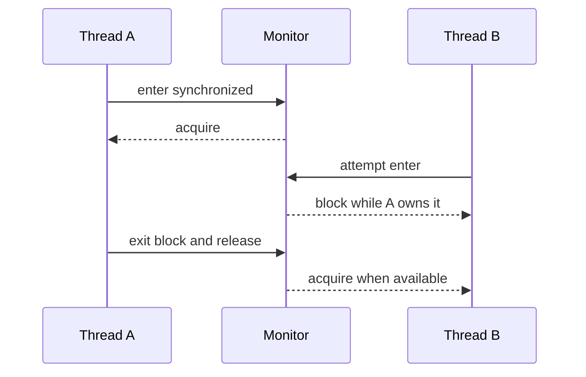

# 21. How does the synchronized keyword work internally?

> Section: Synchronization and Locks · Java 8 baseline · [Section guide](README.md)

## Answer and deep dive

Entering a `synchronized` method or block acquires the monitor associated with its lock object. Only one thread can own that monitor at a time. The JVM implements this contract and may optimize uncontended or well-behaved locks; the Java specification does not require a particular machine instruction or lock representation.

The monitor is released on every exit path, including an exception. A successful unlock also happens-before a later lock of the same monitor, providing both mutual exclusion and visibility for state consistently guarded by that monitor.

```java
private final Object lock = new Object();
private int balance;

void deposit(int amount) {
    synchronized (lock) {
        balance += amount; // protected invariant
    } // monitor released, even if the block throws
}
```

An instance `synchronized` method uses `this`; a static one uses the declaring class's `Class` object.

## Mermaid: monitor handoff



## Pitfall / architect insight

The lock protects only code that uses that same monitor. Synchronizing on a temporary object or on a publicly accessible object lets other code bypass or interfere with the intended protocol. Keep a private, stable lock and state the invariant it protects.

## Related question

Next: [22. What is a monitor](22.%20What%20is%20a%20monitor.md).
