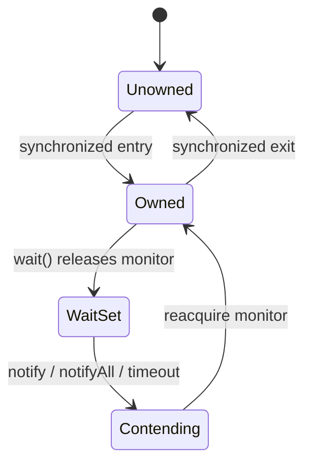

# 22. What is a monitor in Java concurrency?

> Section: Synchronization and Locks · Java 8 baseline · [Section guide](README.md)

## Answer and deep dive

A monitor is an object's built-in synchronization mechanism. It provides an ownership lock for mutual exclusion and an associated wait set used by `wait()`, `notify()`, and `notifyAll()`. Every Java object can act as a monitor.

Only the thread that owns the monitor may call its `wait` or notification methods. `wait()` puts the caller in the wait set and atomically releases that monitor; after notification, timeout, or interruption, the thread must reacquire the monitor before continuing (or throwing `InterruptedException`).

```java
synchronized (lock) {
    while (!ready) {
        lock.wait(); // releases lock while waiting
    }
    useReadyState();
}
```

## Mermaid: monitor lifecycle



## Pitfall / architect insight

Notification is not a stored event and does not transfer ownership. The waiter must recheck its predicate after reacquiring the monitor. Keep the predicate and its updates guarded by the same monitor.

## Related question

Next: [23. What are intrinsic locks](23.%20What%20are%20intrinsic%20locks.md).
