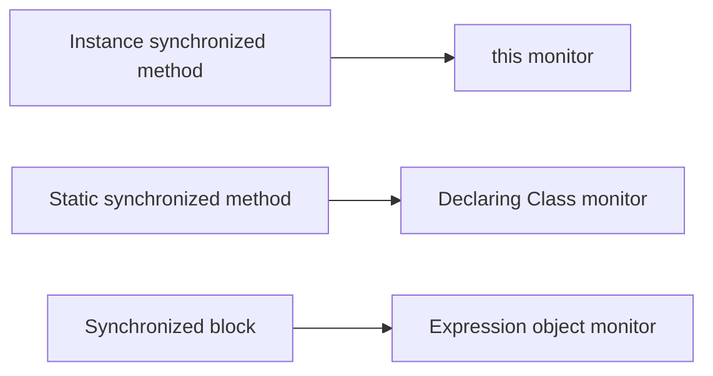

# 23. What are intrinsic locks in Java?

> Section: Synchronization and Locks · Java 8 baseline · [Section guide](README.md)

## Answer and deep dive

An intrinsic lock (monitor lock) is the lock acquired implicitly by `synchronized`. An instance synchronized method locks `this`; a static synchronized method locks the declaring class object; a synchronized block locks the object named by its expression.

Intrinsic locks are reentrant: a thread that already owns a monitor can enter another synchronized region guarded by the same monitor. The JVM tracks the ownership depth and releases the monitor only after the matching exits. Scope is lexical, so the lock is automatically released even on exceptional exit.

```java
final class Counter {
    private int value;
    synchronized void increment() { value++; }
    synchronized int read() { return value; }
}
```

## Mermaid: lock targets



## Pitfall / architect insight

The word `synchronized` does not automatically make every access to a field safe. Every access participating in the invariant must follow a consistent synchronization protocol. Avoid using public objects such as string literals as lock targets.

## Related question

Next: [24. Intrinsic versus explicit locks](24.%20Intrinsic%20versus%20explicit%20locks.md).
