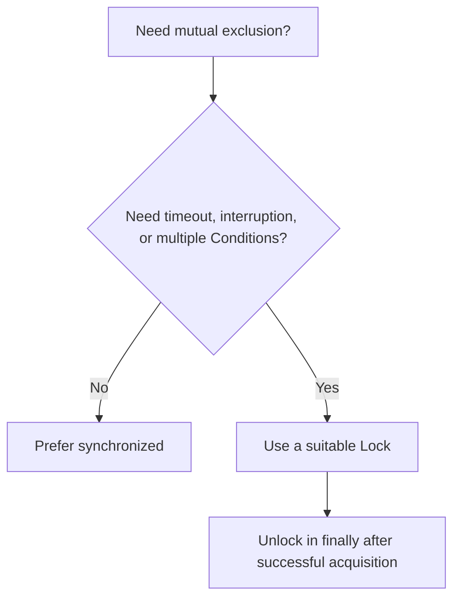

# 24. How are intrinsic locks different from explicit locks?

> Section: Synchronization and Locks · Java 8 baseline · [Section guide](README.md)

## Answer and deep dive

Use `synchronized` for ordinary mutual exclusion: the scope is clear, the JVM releases the monitor automatically, and `wait`/`notify` operate on that monitor. Use `Lock` implementations such as `ReentrantLock` when you need capabilities such as timed or interruptible acquisition, optional fairness, multiple `Condition` wait sets, or lock inspection.

An explicit lock makes the caller responsible for balanced release:

```java
lock.lock();
try {
    updateSharedState();
} finally {
    lock.unlock();
}
```

The `finally` is essential: otherwise an exception can strand the lock permanently. A `Lock` is not inherently faster or safer than an intrinsic lock.

## Mermaid: choosing the primitive



## Pitfall / architect insight

Do not choose explicit locks just because they appear more advanced. Added lifecycle and failure paths are real costs; choose the smallest primitive that meets the requirements and measure before optimizing.

## Related question

Next: [25. What is a reentrant lock](25.%20What%20is%20a%20reentrant%20lock.md).
