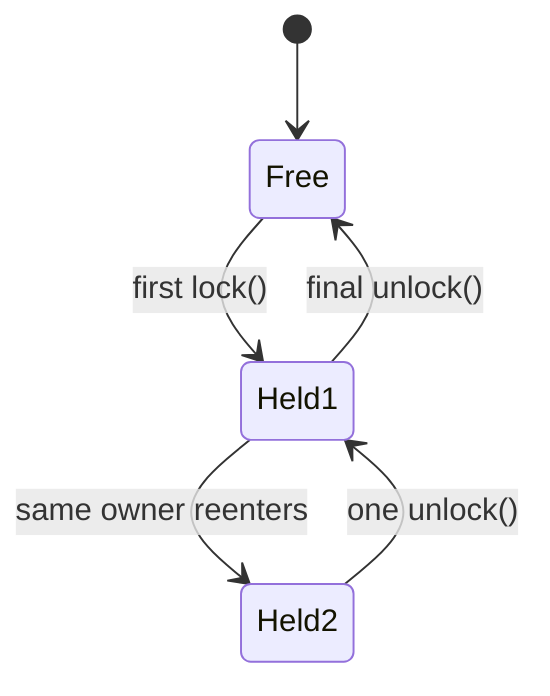

# 25. What is a reentrant lock?

> Section: Synchronization and Locks · Java 8 baseline · [Section guide](README.md)

## Answer and deep dive

A reentrant lock allows its owning thread to acquire the same lock again without deadlocking itself. Each successful acquisition increases a hold count; each matching unlock reduces it. Other threads can acquire the lock only after the count returns to zero.

Both intrinsic monitors (`synchronized`) and `ReentrantLock` are reentrant. Reentrancy is useful when a synchronized method calls another method guarded by the same lock, but it does not make arbitrary lock ordering safe.

```java
private final ReentrantLock lock = new ReentrantLock();

void outer() {
    lock.lock();
    try {
        inner(); // may acquire this lock again
    } finally {
        lock.unlock();
    }
}

void inner() {
    lock.lock();
    try { update(); }
    finally { lock.unlock(); }
}
```

## Mermaid: hold count



## Pitfall / architect insight

Reentrancy can conceal unnecessarily broad critical sections. Every acquisition must have a corresponding release, and calling code that takes a different lock can still create a lock-order deadlock.

## Related question

Next: [26. How does fairness affect ReentrantLock](26.%20How%20does%20fairness%20affect%20ReentrantLock.md).
