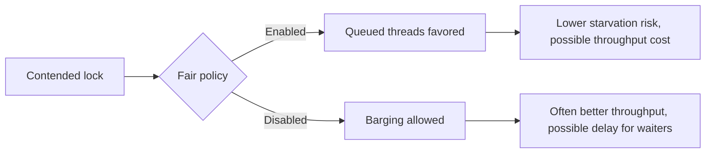

# 26. How does fairness policy affect ReentrantLock?

> Section: Synchronization and Locks · Java 8 baseline · [Section guide](README.md)

## Answer and deep dive

A fair `ReentrantLock` generally favors the longest-waiting thread when the lock becomes available, which can reduce starvation under sustained contention. This policy can lower throughput because it limits barging and adds scheduling overhead. It does not guarantee that the operating system schedules threads fairly or that every waiting thread will make progress promptly.

```java
Lock fair = new ReentrantLock(true);
Lock nonFair = new ReentrantLock(); // default
```

The untimed `tryLock()` may acquire a fair lock immediately even when other threads are queued, so it can barge. Fairness is a policy choice, not a correctness substitute.

## Mermaid: fairness trade-off



## Pitfall / architect insight

Do not enable fairness based only on a theoretical starvation concern. Measure tail latency and throughput under realistic contention, then define an acceptable progress policy.

## Related question

Next: [27. How do you use timed tryLock()](27.%20How%20do%20you%20use%20timed%20tryLock%28%29.md).
