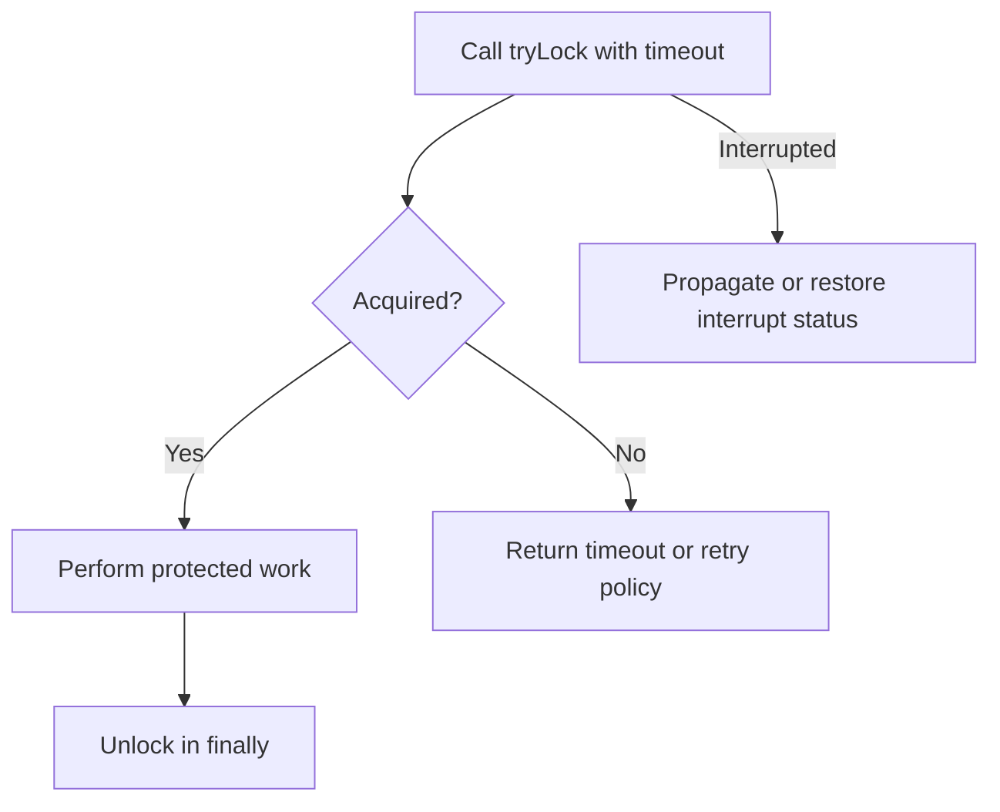

# 27. How do you use tryLock() with timeouts?

> Section: Synchronization and Locks · Java 8 baseline · [Section guide](README.md)

## Answer and deep dive

`tryLock(timeout, unit)` waits up to the given duration to acquire a `Lock`, returning `true` only when acquisition succeeds. It is interruptible, so callers must preserve or handle interruption according to their API contract. Unlock only after a successful acquisition.

```java
if (lock.tryLock(200, TimeUnit.MILLISECONDS)) {
    try {
        updateSharedState();
    } finally {
        lock.unlock();
    }
} else {
    recordBusyOrRetry();
}
```

A timeout means the operation did not obtain the lock; it must not be treated as though the protected action occurred. Choose a timeout and fallback that fit the caller's latency and consistency requirements.

## Mermaid: acquisition outcomes



## Pitfall / architect insight

Avoid retry loops that immediately call `tryLock` again: they can waste CPU and worsen contention. Use bounded retries, backoff, or a caller-visible timeout policy.

## Related question

Next: [28. What is ReadWriteLock for](28.%20What%20is%20ReadWriteLock%20for.md).
