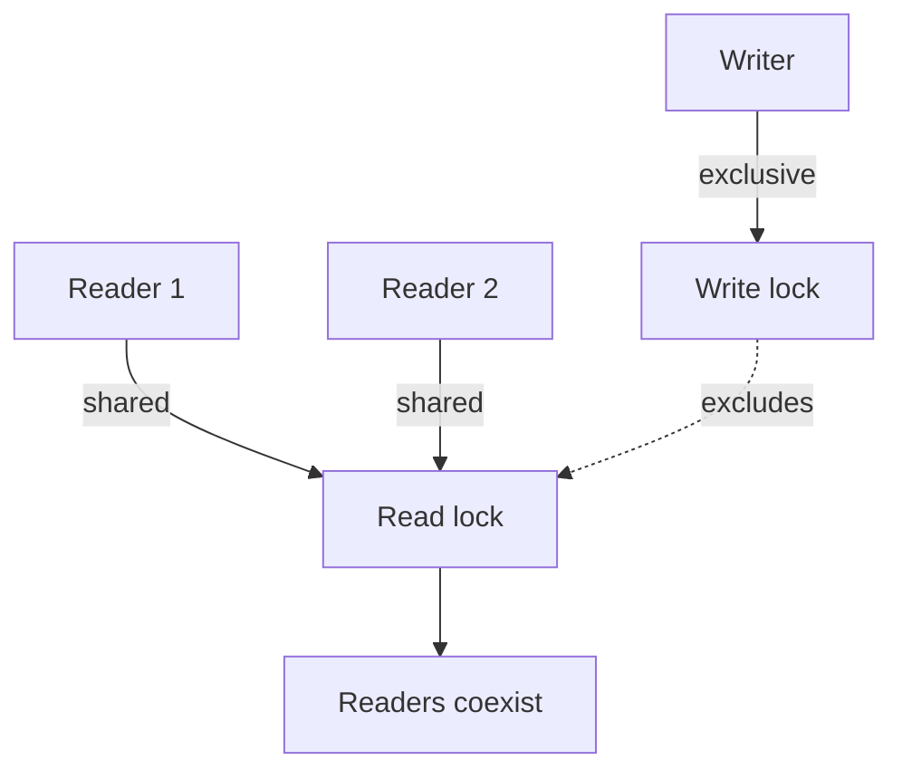

# 28. What is the purpose of ReadWriteLock?

> Section: Synchronization and Locks · Java 8 baseline · [Section guide](README.md)

## Answer and deep dive

A `ReadWriteLock` separates shared read access from exclusive write access. Multiple readers can hold the read lock simultaneously; a writer excludes both readers and other writers. This can help when reads greatly outnumber writes and the protected work is large enough to offset the extra coordination.

```java
ReadWriteLock rw = new ReentrantReadWriteLock();
rw.readLock().lock();
try {
    return snapshot();
} finally {
    rw.readLock().unlock();
}
```

Writers should use `writeLock()` with the same `try/finally` discipline. A read-write lock may perform worse than a simple mutex for short operations, frequent writes, or high lock-management overhead.

## Mermaid: reader and writer access



## Pitfall / architect insight

Do not assume every read-heavy workload benefits. Benchmark under realistic read/write ratios and hold times, and consider starvation and fairness requirements.

## Related question

Next: [29. How can ReentrantReadWriteLock improve concurrency](29.%20How%20can%20ReentrantReadWriteLock%20improve%20concurrency.md).
