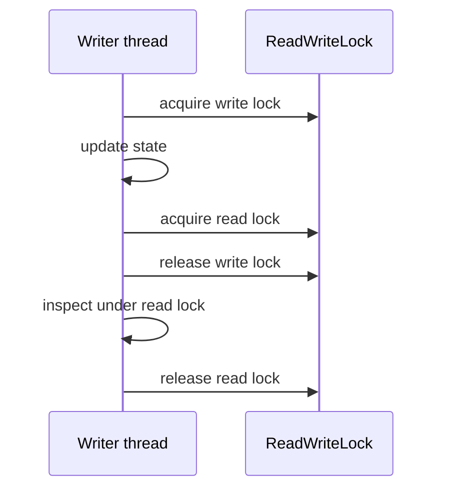

# 29. How does ReentrantReadWriteLock improve concurrency?

> Section: Synchronization and Locks · Java 8 baseline · [Section guide](README.md)

## Answer and deep dive

`ReentrantReadWriteLock` permits concurrent readers while preserving exclusive writes. It is most useful when reads are common, writes are relatively rare, and operations are long enough that removing reader-reader serialization matters.

It does not support upgrading safely by acquiring the write lock while holding a read lock: the thread can wait for its own read hold to disappear. Downgrading is supported by acquiring the write lock, updating, acquiring the read lock, then releasing the write lock.

```java
write.lock();
try {
    update();
    read.lock();        // downgrade while write still held
} finally {
    write.unlock();
}
try {
    inspect();
} finally {
    read.unlock();
}
```

## Mermaid: downgrade sequence



## Pitfall / architect insight

Frequent writes can block readers and erase the benefit; short critical sections often favor a simpler lock. Keep read and write lock acquisition order consistent and benchmark the actual workload.

## Related question

Next: [30. What is StampedLock and how does it differ](30.%20What%20is%20StampedLock%20and%20how%20does%20it%20differ.md).
