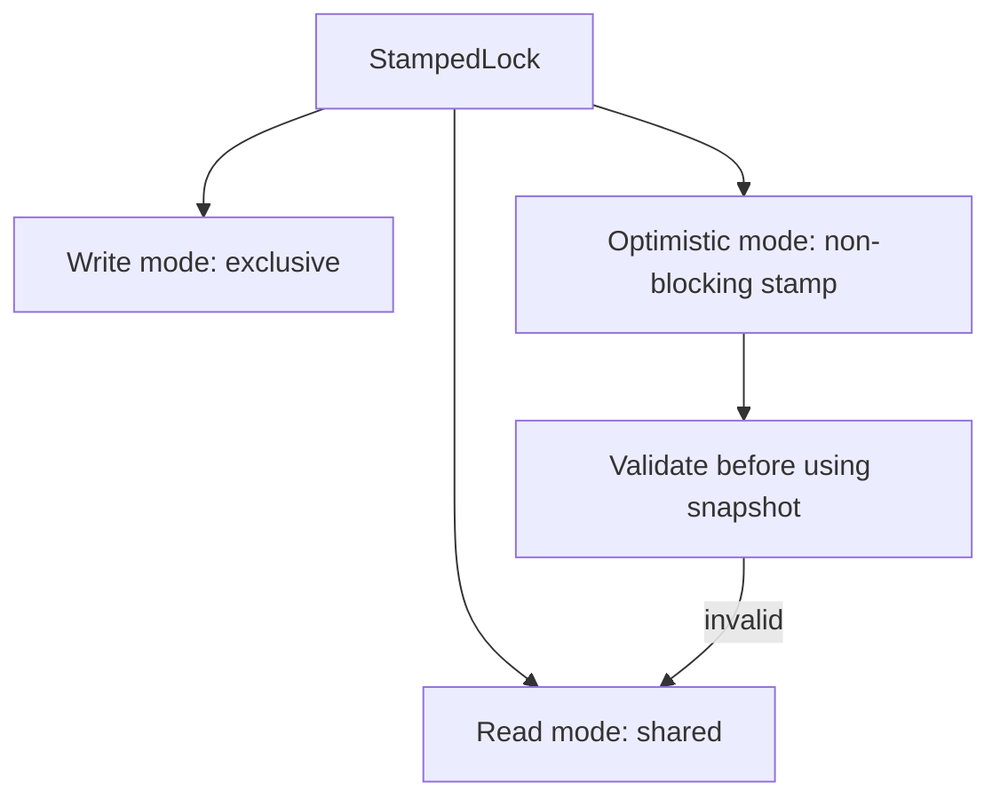

# 30. What is StampedLock and how does it differ from ReentrantLock?

> Section: Synchronization and Locks · `StampedLock` was added in Java 8 · [Section guide](README.md)

## Answer and deep dive

`StampedLock` (Java 8) provides read, write, and optimistic-read modes. Each acquisition returns a stamp token used to validate or release that mode. Unlike `ReentrantReadWriteLock`, it is not reentrant and does not implement `ReadWriteLock`; its stamps represent lock state, not thread ownership.

Optimistic reads can avoid blocking a writer, but the observed data may be inconsistent until the stamp validates. It offers no `Condition` support and is easier to misuse than conventional locks.

```java
StampedLock lock = new StampedLock();
long stamp = lock.readLock();
try {
    readConsistentState();
} finally {
    lock.unlockRead(stamp);
}
```

## Mermaid: available modes



## Pitfall / architect insight

Do not assume a stamp can be unlocked by any `unlock` method or that lock reentrance is allowed. Match the acquisition mode to its corresponding release/validation API, and keep code paths short and auditable.

## Related question

Next: [31. What is optimistic locking in StampedLock](31.%20What%20is%20optimistic%20locking%20in%20StampedLock.md).
