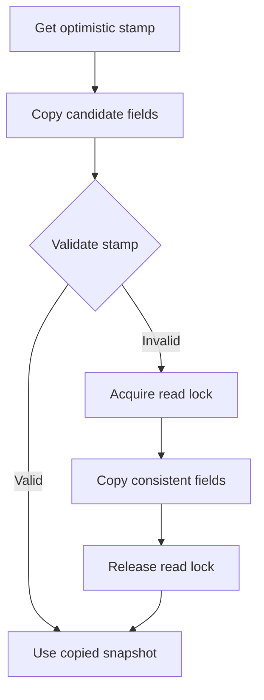

# 31. What is optimistic locking in StampedLock?

> Section: Synchronization and Locks · `StampedLock` was added in Java 8 · [Section guide](README.md)

## Answer and deep dive

An optimistic read obtains a stamp without blocking a writer, copies the fields it needs, and validates the stamp. If a write overlapped, validation fails: discard the possibly inconsistent values and retry while holding a read lock.

```java
long stamp = lock.tryOptimisticRead();
int observed = value;
if (!lock.validate(stamp)) {
    stamp = lock.readLock();
    try {
        observed = value;
    } finally {
        lock.unlockRead(stamp);
    }
}
return observed;
```

Copy data into locals before validation and use it only after validation succeeds. Optimistic reads are appropriate for read-mostly state where retrying is acceptable.

## Mermaid: validate or retry



## Pitfall / architect insight

Validation does not retroactively make earlier side effects safe. Do not call external code, mutate state, or make irreversible decisions using unvalidated values.

## Related question

Next: [32. How do condition variables work](32.%20How%20do%20condition%20variables%20work.md).
