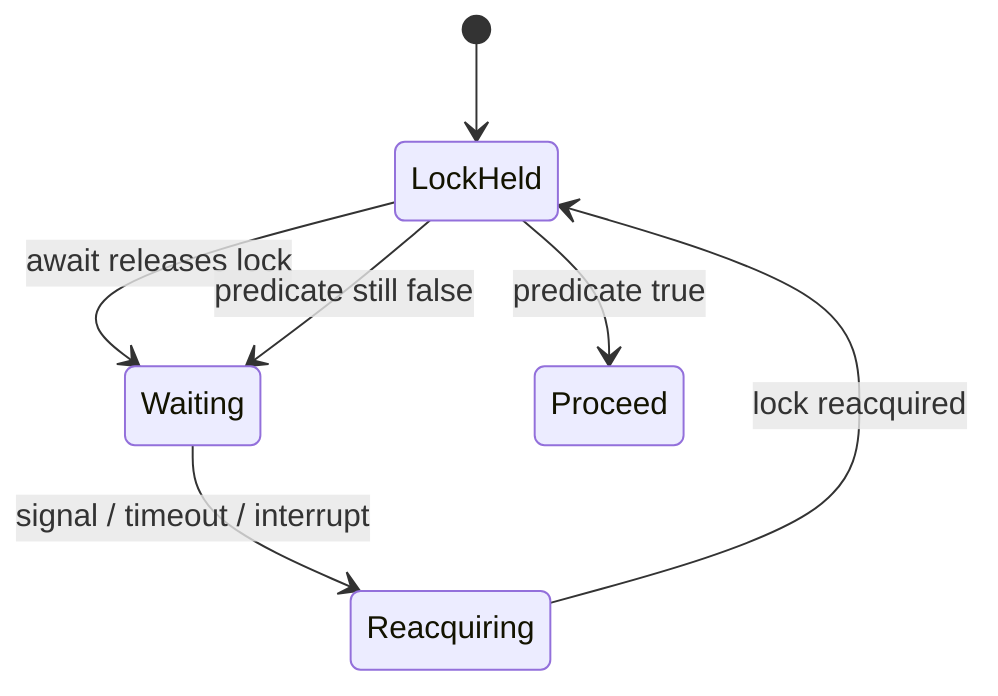

# 32. How do condition variables work in Java?

> Section: Synchronization and Locks · Java 8 baseline · [Section guide](README.md)

## Answer and deep dive

A `Condition` provides a wait set associated with a `Lock`, allowing a program to represent distinct predicates under the same lock. `await()` atomically releases the associated lock and suspends the caller. After a signal, timeout, or interruption, it reacquires the lock before returning or throwing.

A condition is only a notification mechanism; the shared predicate remains the source of truth. Protect predicate reads and updates using the associated lock.

```java
Lock lock = new ReentrantLock();
Condition available = lock.newCondition();
boolean ready;
```

## Mermaid: await and reacquire



## Pitfall / architect insight

Never treat a signal as proof that the predicate is true. Spurious wakeups and competing waiters require checking the predicate in a loop after reacquiring the lock.

## Related question

Next: [33. How do you use await() and signal()](33.%20How%20do%20you%20use%20await%28%29%20and%20signal%28%29.md).
