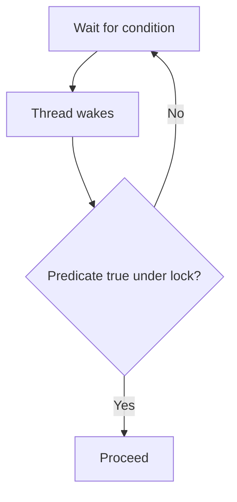

# 34. What is spurious wakeup?

> Section: Synchronization and Locks · Java 8 baseline · [Section guide](README.md)

## Answer and deep dive

A waiting thread can return from `Object.wait()` or `Condition.await()` without the event the application expected. Even a legitimate notification may be meant for a different predicate. Therefore returning from a wait never proves that the condition is true.

Always recheck the condition while holding its lock:

```java
lock.lock();
try {
    while (!ready) {
        readyCondition.await();
    }
    consume();
} finally {
    lock.unlock();
}
```

The loop handles spurious returns, competition between waiters, and notifications that wake threads with another predicate.

## Mermaid: wakeup is not readiness



## Pitfall / architect insight

Replacing `while` with `if` creates an intermittent correctness bug that may be difficult to reproduce. For timed waits, use a deadline and recompute remaining time after every wakeup.

## Related question

Next: [35. Why check wait conditions in a loop](35.%20Why%20check%20wait%20conditions%20in%20a%20loop.md).
